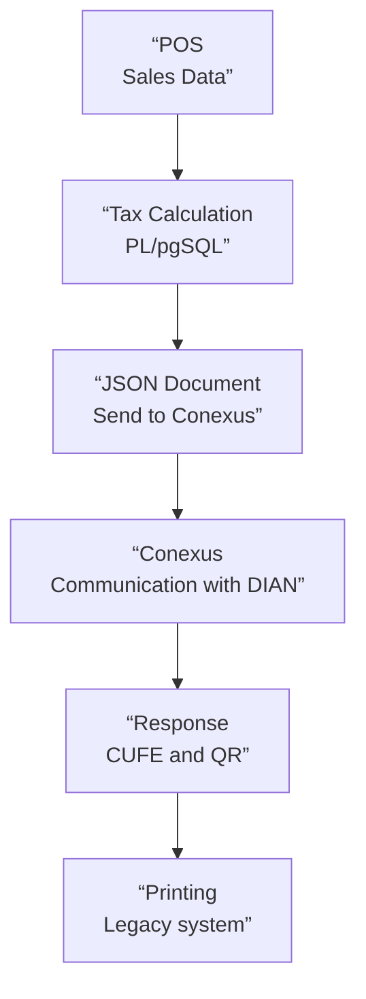

# Real-Time Electronic Invoicing: Tax Reconstruction and Integration with Legacy Systems

> Case study of a legacy enterprise integration that I took on and developed between 2024 and 2025. I describe the engineering challenge, the decisions made, and their limitations. I do not include production code, complete SQL queries, internal formulas, identifiable invoice data, service addresses, credentials, or infrastructure topology.

---

## Summary

| Aspect | Context |
|---|---|
| **Role** | Technical responsibility for an integration received in an incomplete state; diagnosis, implementation, and ongoing maintenance |
| **Problem** | Adapting batch billing to real-time processing with incomplete and inconsistent tax information at the POS |
| **Relevant Stack** | PostgreSQL, PL/pgSQL, Python, web services, JSON, XML, and legacy printing components |
| **Technology Provider** | Conexus: reception and validation by the provider; direct communication with the DIAN handled by Conexus |
| **Operational Constraint** | Target of five seconds per invoice to avoid disrupting checkout service |
| **Timeframe** | Main work in 2024, with documented corrections and updates through September 2025 |

This case differs from the **POS–Siesa** integration, which sends commercial information to the ERP and is documented in the [Siesa case study](./case-study-siesa.md). Here, the objective was to prepare the tax data, process it through a technology provider, and adapt the output to the requirements of electronic invoicing.

---

## Context: From Batch Processing to Real-Time Processing

When I took over the integration, between April and May 2024, the project already existed but was incomplete. The previous workflow operated using batch processing and needed to be adapted to the real-time processing requirements in effect for the operation.

The problem was twofold:

1. The invoice had to be processed while the sale was still being processed, without turning a checkout transaction into a prolonged wait.
2. The point-of-sale system did not directly store all the amounts and tax breakdowns required for integration with the technology provider.

The obligation to provide consistent data did not disappear simply because the POS system was legacy. We had to reconstruct the data without immediately rewriting that system and without losing the traceability of the original transaction.

I was assigned technical responsibility for this work without a formal handover process. Before implementing general changes, it was necessary to study the system outputs, understand how transactions were represented, and reproduce the errors.

---

## 1. The Problem with Source Data

### Insufficient Data to Issue the Document

The POS records contained information such as product, quantity, price, discounts, and tax rate, but not all the consolidated tax values that the integration was required to transmit.

Tax amounts and components had to be derived from records that had been designed for a different purpose: processing the sale, not necessarily representing all elements of the electronic document.

### Different Conventions for Sales and Returns

The problems were not identical across transactions.

In some partial returns of products sold by weight, the adjustment could be represented as a negative price variation while the quantity remained positive. For other products, negative quantities and amounts followed different conventions. Credit memos and reversal documents added further possibilities for sign changes.

This made it risky to interpret the stored value of each column in isolation. The meaning depended on the **type of transaction** and how the POS had recorded its movements.

### Discounts and Rounding

There were also discrepancies between what the POS displayed during the sale and the data ultimately stored, as well as differences in decimal places for taxes and discounts.

A seemingly minor detail could cause a difference in the document’s tax total. The challenge was not simply formatting a JSON file; it was determining which amounts accurately represented the business transaction and how to reconcile the calculations without masking underlying errors.

For confidentiality reasons, I am not reproducing exact combinations of business rules, internal formulas, or transaction records.

---

## 2. Diagnosis: From Isolated Cases to Reusable Patterns

Before generalizing a correction, I collected and analyzed **more than twenty actual invoices with different patterns of inconsistency**.

The task involved reconstructing the amounts, comparing the system outputs, and classifying discrepancies related to:

- Conventions for quantities and amounts based on the type of transaction.
- Discounts and value distributions that did not match between display and storage.
- Taxes and differences caused by rounding.
- Reversals, refunds, and notes associated with previous documents.

The goal was not to manually correct each invoice once and for all. It was to convert these cases into reproducible calculation criteria and expand the handling of new situations as they arose.

**Lesson:** When a source system does not guarantee uniform tax representation, the integration must understand the domain and validate its assumptions; a direct field mapping is insufficient.

---

## 3. Tax Recalculation with PL/pgSQL Without Altering the Source

I developed functions and logic in **PL/pgSQL** to reconstruct the values required for integration based on the available information.

The implementation incorporated differentiated transaction handling and an iterative recalculation mechanism to reconcile amounts when the initial values did not balance, taking into account the peculiarities observed in the records and rounding.

> **Engineering decision:** Calculate a consistent tax representation for the document **without rewriting the original point-of-sale records**.

This had two advantages: it preserved the source data for auditing purposes and avoided introducing a new write dependency on a legacy system that was not under the same development control.

At the same time, it maintained a significant limitation: the calculation did not correct the behavior of the POS that originally caused the inconsistency. The integration had to continue distinguishing between source errors and transformation errors.

I do not publish SQL queries, exact reconstruction conditions, adjustment algorithms, or proprietary business rules.

---

## 4. Real-Time Workflow and Integration with Conexus

The next step was to adapt a batch-processing system to a workflow in which the document would be handled during the sales process.

The operational limit set was **five seconds per invoice**. This required us to consider the cost of calculating values, building the document, and communicating with an external system without compromising checkout efficiency.

The integration combined SQL logic on the source data with Python components that consolidated the information, built the JSON message, and called the **Conexus** web service.

### Boundaries of Responsibility

It is important to be precise:

- **Our work:** interpretation and reconstruction of tax data, integration with Conexus services, processing of responses, and adaptation of the results to the checkout process.
- **Conexus:** technology provider that communicates directly with the DIAN and provides validation results and elements associated with the document.
- **Legacy systems:** point-of-sale and printing mechanisms, with pre-existing capabilities and limitations.

I did not implement a direct integration with the DIAN via SOAP/XML, nor did I develop the CUFE generation mechanism. Nor do I attribute to the project an average time or latency percentile that has not been measured: the five seconds represent the **operational design goal**.

### Document Conceptual Flow

*Logical flow; does not correspond to an actual server or network topology.*

---

## 5. QR and CUFE in a Legacy Printing System

An additional requirement was to include the QR code and CUFE associated with the document on the sales receipt.

The integration with Conexus provided the **pre-generated CUFE** and the **base64-encoded QR code**. My responsibility was to retrieve that data, prepare the QR code image, and figure out how to incorporate it so that the printing system could use it.

Since the POS system was designed to print text directly, not images, I adapted the QR code output so that the legacy printing system could incorporate it into the receipt without replacing that component.

This illustrates a common problem in enterprise integration: **the output contract does not end with the API response**. The information must be delivered in a format that the final system in the process can use.

---

## 6. Handling Returns and Credit Memos

Returns presented situations that differed from ordinary sales.

For certain **full returns**, I leveraged the **XML from the invoice already issued** through the technology provider. Instead of reconstructing all the calculations from the POS data, I read and transformed the values from the previously consolidated document to generate the corresponding credit memo.

This strategy recognized that the document already issued contained reconciled tax information that could serve as a reference for its complete reversal.

Technical precision is important: **I read and transformed an existing XML file; I did not construct XML messages to send directly to the DIAN**.

The logic behind partial returns and other situations required a different approach. It would not be correct to present the use of XML from a full return as a universal solution for all credit memos.

---

## 7. Subsequent Developments in Production

The initial adaptation was not the end of the work. Throughout 2024, I continued to address source errors and tax adjustments that arose in real-world cases.

In 2025, additional developments were documented:

- **January:** Implementation of the global discount treatment in electronic invoicing.
- **August:** Implementation of the treatment related to ICUI.

These improvements correspond to new cases addressed in the integration and do not imply that I developed the technology provider’s validation platform.

---

## Verifiable Results

- Transition from a legacy batch-processing integration to a real-time processing workflow using Conexus.
- Implementation of a mechanism for reconstructing and reconciling tax amounts using **PL/pgSQL**, without altering the original POS records.
- Investigation of **more than twenty cases** of invoicing to identify recurring patterns of inconsistencies.
- Utilization of the technology provider’s services, including handling responses that contain CUFE and base64-encoded QR codes.
- Adaptation of the QR code to the legacy printing system.
- Resolution of specific scenarios involving full refunds by reading and transforming previously issued XML files.
- Evolutionary maintenance and coverage of new cases related to discounts throughout 2025.

I do not attribute to the project unmeasured figures regarding rejection reduction, validation success rates, cost savings, or compliance with a statistical latency threshold across all invoices.

---

## Restrictions, Limits, and Retrospective Analysis

**Separation of Responsibilities.** Reconstructing a coherent tax representation without modifying the POS addressed the immediate need, but introduced transformation logic that had to be maintained in the face of new source patterns. Correcting the integration was not the same as correcting the system that provided the data.

**Dependencies and restrictions.** The five-second target also depended on the remote service. The integration was complete when the QR code could be incorporated into the actual printing process, not when the vendor returned its response.

**Diversity of documents.** Sales, returns, credit memos, discounts, and rounding required interpreting the amounts based on the specific transaction, rather than applying a single formula.

### What I would reconsider today

I would prefer a more explicit separation between tax data normalization, validations, communication with the provider, and adapting the response for the cash register. This would make it easier to test each stage with representative cases and observe more clearly where an inconsistency or degradation occurs.

This is a **retrospective** observation, not a claim that a new architecture with those layers fully decoupled has been implemented.

---

## Engineering Reflection

This project forced me to solve a problem that is often hidden behind the phrase “integrating an API”: **obtaining accurate data when the source system does not represent it in the format required by the destination**.

The most valuable part was combining the analysis of real transactions, data logic, integration with an external provider, and adaptation of a legacy system under operational constraints.

This lesson carried over to subsequent projects: before correcting an inconsistency between systems, it is necessary to determine what each piece of data means, where it is transformed, and who is responsible for each stage.

---

[← Back to portfolio](./README.md)
