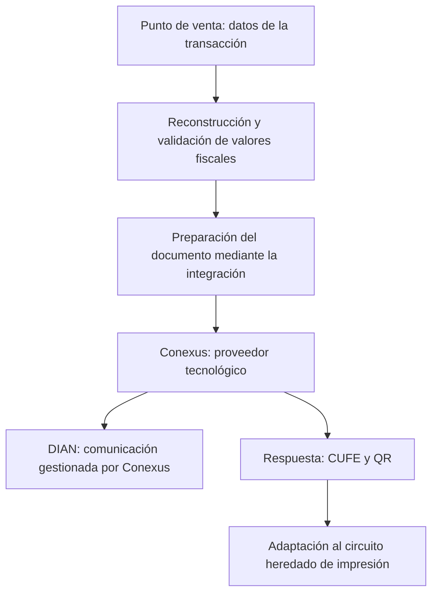

# Facturación electrónica en tiempo real: reconstrucción fiscal e integración con sistemas heredados

> Caso de estudio de una integración empresarial heredada que asumí y evolucioné entre 2024 y 2025. Describo el problema de ingeniería, las decisiones tomadas y sus límites. No incluyo código de producción, consultas SQL completas, fórmulas internas, datos de facturas identificables, direcciones de servicios, credenciales ni topología de infraestructura.

---

## En breve

| Aspecto | Contexto |
|---|---|
| **Rol** | Responsabilidad técnica sobre una integración recibida incompleta; diagnóstico, implementación y mantenimiento evolutivo |
| **Problema** | Adaptar facturación por lotes a procesamiento en tiempo real con información fiscal incompleta e inconsistente en el POS |
| **Stack relevante** | PostgreSQL, PL/pgSQL, Python, servicios web, JSON, XML y componentes heredados de impresión |
| **Proveedor tecnológico** | Conexus: recepción y validación por el proveedor; comunicación directa con la DIAN a cargo de Conexus |
| **Restricción operacional** | Objetivo de cinco segundos por factura para no perjudicar el servicio en caja |
| **Periodo** | Trabajo principal en 2024, con correcciones y evolución documentadas hasta septiembre de 2025 |

Este caso es distinto de la integración **POS–Siesa**, que envía información comercial al ERP y se documenta en el [caso de Siesa](./case-study-siesa.md). Aquí el objetivo era preparar los datos fiscales, procesarlos mediante un proveedor tecnológico y adaptar la salida a las necesidades de facturación electrónica.

---

## Contexto: de procesos por lotes a procesamiento en tiempo real

Cuando recibí la integración, entre abril y mayo de 2024, el proyecto ya existía, pero estaba incompleto. El flujo anterior operaba mediante envíos por lotes y debía adaptarse a los requisitos de procesamiento en tiempo real vigentes para la operación.

El problema era doble:

1. La factura debía procesarse mientras la venta aún se estaba atendiendo, sin convertir una operación de caja en una espera prolongada.
2. El punto de venta no conservaba directamente todos los importes y discriminaciones fiscales que necesitaba la integración con el proveedor tecnológico.

La obligación de entregar datos coherentes no desaparecía porque el POS fuera heredado. Había que reconstruirlos sin reescribir inmediatamente ese sistema y sin perder la trazabilidad de la transacción original.

Recibí la responsabilidad técnica de este trabajo sin un proceso de transferencia formal. Antes de implementar cambios generales fue necesario estudiar las salidas de los sistemas, entender cómo se representaban las operaciones y reproducir los errores.

---

## 1. El problema de los datos de origen

### Datos insuficientes para emitir el documento

Los registros del POS contenían información como producto, cantidad, precio, descuentos y porcentaje de impuesto, pero no todos los valores fiscales consolidados que debía transmitir la integración.

Había que derivar importes y componentes tributarios a partir de registros que habían sido diseñados para otra necesidad: operar la venta, no necesariamente representar todos los elementos del documento electrónico.

### Convenciones diferentes para ventas y devoluciones

Los problemas no eran idénticos entre operaciones.

En algunas devoluciones parciales de productos vendidos por peso, el ajuste podía quedar representado como una variación negativa del precio mientras la cantidad seguía siendo positiva. En otros productos, las cantidades negativas y los importes seguían convenciones distintas. Las notas y documentos de reversión añadían más posibilidades de cambio de signos.

Esto hacía peligroso interpretar el valor almacenado de cada columna de forma aislada. El significado dependía del **tipo de transacción** y de cómo el POS había registrado sus movimientos.

### Descuentos y redondeos

También aparecían discrepancias entre lo que el POS mostraba durante la venta y los datos finalmente almacenados, así como diferencias de decimales en impuestos y descuentos.

Un dato aparentemente pequeño podía provocar una diferencia en el total fiscal del documento. La dificultad no era simplemente formatear un JSON: era determinar qué importes representaban correctamente la operación comercial y cómo reconciliar los cálculos sin ocultar errores de origen.

Por confidencialidad no reproduzco combinaciones exactas de reglas comerciales, fórmulas internas ni registros de transacciones.

---

## 2. Diagnóstico: de casos aislados a patrones reutilizables

Antes de generalizar una corrección recopilé y analicé **más de veinte facturas reales con patrones distintos de inconsistencia**.

El trabajo consistió en reconstruir los importes, comparar las salidas de los sistemas y clasificar diferencias relacionadas con:

- Convenciones de cantidad e importe según el tipo de operación.
- Descuentos y distribuciones de valores que no coincidían entre representación y almacenamiento.
- Impuestos y diferencias introducidas por redondeo.
- Reversiones, devoluciones y notas asociadas a documentos previos.

El propósito no era corregir manualmente cada factura para siempre. Era convertir esos casos en criterios de cálculo reproducibles y ampliar el tratamiento de nuevas situaciones cuando aparecieran.

**Lección:** cuando un sistema de origen no garantiza una representación fiscal uniforme, la integración necesita comprender el dominio y validar sus supuestos; un mapeo directo de campos es insuficiente.

---

## 3. Recálculo fiscal con PL/pgSQL sin alterar el origen

Desarrollé funciones y lógica en **PL/pgSQL** para reconstruir los valores que requería la integración a partir de la información disponible.

La implementación incorporó tratamiento diferenciado de transacciones y un mecanismo iterativo de recálculo para conciliar importes cuando los valores iniciales no cuadraban, atendiendo las peculiaridades observadas en los registros y el redondeo.

La decisión de ingeniería fue **calcular una representación coherente para el documento sin reescribir los registros originales del punto de venta**.

Eso tenía dos ventajas: conservaba el dato de origen para auditoría y evitaba introducir una nueva dependencia de escritura sobre un sistema legado que no estaba bajo el mismo control de desarrollo.

Al mismo tiempo, mantenía una limitación importante: el cálculo no corregía el comportamiento del POS que generó originalmente una inconsistencia. La integración debía seguir distinguiendo entre errores de origen y errores de transformación.

No publico consultas SQL, condiciones exactas de reconstrucción, algoritmos de ajuste ni reglas de negocio propietarias.

---

## 4. Flujo en tiempo real e integración con Conexus

El siguiente paso fue adaptar un esquema de envíos por lotes a un proceso en el que el documento se atendiera durante el flujo de venta.

El límite operativo planteado era de **cinco segundos por factura**. Eso obligó a pensar en el costo de calcular los valores, construir el documento y comunicarse con un sistema externo sin deteriorar la atención en caja.

La integración combinó lógica SQL en los datos de origen con componentes en Python que consolidaban la información, construían el mensaje JSON y consumían el webservice de **Conexus**.

### Frontera de responsabilidades

Es importante ser preciso:

- **Trabajo propio:** interpretación y reconstrucción de los datos fiscales, integración con los servicios de Conexus, procesamiento de respuestas y adaptación de los resultados al flujo de caja.
- **Conexus:** proveedor tecnológico que realiza la comunicación directa con la DIAN y proporciona los resultados de validación y los elementos asociados al documento.
- **Sistemas heredados:** punto de venta y mecanismo de impresión, con capacidades y restricciones preexistentes.

No implementé una integración directa con la DIAN mediante SOAP/XML ni desarrollé el mecanismo de generación del CUFE. Tampoco atribuyo al proyecto un tiempo promedio o un percentil de latencia que no se haya medido: los cinco segundos representan el **objetivo operacional de diseño**.

El esquema siguiente es lógico, no una descripción de servidores o despliegues:

---

## 5. QR y CUFE en un circuito de impresión heredado

Una exigencia adicional fue incluir en la tirilla de venta el código QR y el CUFE asociados al documento.

La integración con Conexus entregaba el **CUFE ya generado** y el **QR codificado en base64**. Mi responsabilidad fue obtener esos datos, preparar la imagen del QR y resolver su publicación para que pudiera utilizarla el sistema que realizaba la impresión.

Como el circuito de caja estaba diseñado para imprimir texto y no imágenes de forma directa, adapté la publicación del QR para que el sistema de impresión heredado pudiera incorporarlo a la tirilla sin reemplazar ese componente.

Esto demuestra una clase de problema frecuente en integración empresarial: **el contrato de salida no termina en la respuesta de la API**. La información debe llegar en un formato que pueda utilizar el último sistema del proceso.

---

## 6. Tratamiento de devoluciones y notas

Las devoluciones introducían situaciones diferentes de una venta ordinaria.

Para determinadas **devoluciones totales**, aproveché el **XML de la factura ya emitida** por medio del proveedor tecnológico. En lugar de reconstruir todos los cálculos desde los datos del POS, leía y transformaba los valores del documento previamente consolidado para generar la nota correspondiente.

Esta estrategia reconocía que el documento ya emitido contenía información fiscal reconciliada que podía servir de referencia para su reversión completa.

La precisión técnica es importante: **leí y transformé un XML existente; no construí mensajes XML para enviarlos directamente a la DIAN**.

La lógica de devoluciones parciales y otras situaciones requería un tratamiento distinto. No sería correcto presentar el aprovechamiento del XML de una devolución total como solución universal para todas las notas.

---

## 7. Evolución posterior en producción

La adaptación inicial no agotó el trabajo. Durante 2024 continué atendiendo errores de origen y transformaciones fiscales que aparecían con casos reales.

En 2025 hubo evolución adicional documentada:

- **Enero:** incorporación del tratamiento de descuento global en la factura electrónica.
- **Agosto:** incorporación del tratamiento relacionado con ICUI.

Estas mejoras corresponden a nuevos casos tratados en la integración y no implican que haya desarrollado la plataforma de validación del proveedor tecnológico.

---

## Resultados verificables

- Evolución de una integración heredada de envíos por lotes hacia un flujo de procesamiento en tiempo real mediante Conexus.
- Implementación de un mecanismo de reconstrucción y conciliación de importes fiscales con **PL/pgSQL**, sin alterar los registros originales del POS.
- Investigación de **más de veinte casos** de facturación para identificar patrones repetibles de inconsistencias.
- Consumo de servicios del proveedor tecnológico con tratamiento de respuestas que incluyen CUFE y QR en base64.
- Adaptación del QR al circuito de impresión heredado.
- Resolución de determinados escenarios de devoluciones totales mediante lectura y transformación de XML ya emitidos.
- Mantenimiento evolutivo y cobertura de nuevos casos relacionados con descuentos durante 2025.

No atribuyo al proyecto cifras no medidas de reducción de rechazos, porcentajes de éxito de validación, ahorro económico ni cumplimiento de una latencia estadística en todas las facturas.

---

## Restricciones, límites y retrospectiva

**El POS era una fuente heredada.** No podía asumir que sus campos constituyeran por sí solos el documento fiscal completo ni alterar libremente el sistema de origen. Construir una representación consistente en la capa de integración resolvía una necesidad real, pero añadía lógica que debía mantenerse cuando cambiaban los patrones de operación.

**El tiempo operativo estaba condicionado por un tercero.** El límite de cinco segundos era un requisito importante, pero el comportamiento extremo de un servicio remoto no está bajo control del sistema que lo consume. Un diseño robusto requiere reconocer esa dependencia y distinguir objetivos de tiempos de mediciones verificadas.

**Las reglas fiscales exigían análisis de casos.** No se trataba de utilizar una única fórmula para todos los documentos. Cantidades, devoluciones, notas, descuentos y redondeos podían tener distintas representaciones según el origen y el tipo de transacción.

**La impresión era parte de la integración.** Obtener un QR válido de un proveedor tecnológico no bastaba si el circuito de caja no podía mostrarlo. Integrar sistemas implica también resolver las fronteras de formato y capacidades de los componentes heredados.

**No todo problema debía arreglarse en la misma capa.** Cuando un dato incorrecto nacía en el POS, la integración podía necesitar tratamiento para atender la operación, pero esa adaptación no convertía el comportamiento original en correcto.

### Qué reconsideraría hoy

Preferiría una separación más explícita entre normalización de datos fiscales, validaciones, comunicación con el proveedor y adaptación de la respuesta a la caja. Esto facilitaría probar cada etapa con casos representativos y observar con mayor claridad dónde aparece una inconsistencia o una degradación.

Esa consideración es una **retrospectiva**, no una afirmación de que se haya implementado una arquitectura nueva con esas capas totalmente desacopladas.

---

## Reflexión de ingeniería

Este proyecto me obligó a resolver un problema que suele quedar oculto detrás de la expresión «integrar una API»: **obtener datos correctos cuando el sistema de origen no los representa de la forma que exige el destino**.

La parte más valiosa fue combinar diagnóstico de transacciones reales, lógica de datos, integración con un proveedor externo y adaptación de un circuito legado bajo restricciones operativas.

La lección se extendió a proyectos posteriores: antes de corregir una inconsistencia entre sistemas, es necesario determinar qué significa cada dato, dónde se transforma y quién es responsable de cada etapa.
