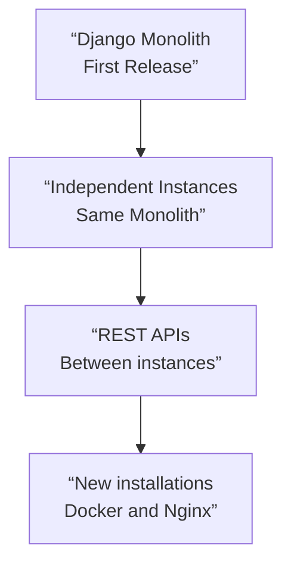

# LogiX: Evolution of a Critical Logistics Distribution Platform

> This document describes engineering decisions and the reasoning behind them. It does not detail production topology, infrastructure configuration, complete business rules, or data structures, for confidentiality and security reasons.

## Summary

| Aspect | Context |
|---|---|
| **Role** | Technical leadership of initial development and ongoing responsibility for the product in production |
| **Problem** | Operational bottlenecks and inconsistencies in distribution, with mandatory dependence on the ERP |
| **Initial Decision** | Django monolith built on familiar technology to deliver with a small team |
| **Evolution** | Independent instances communicating via REST APIs, containerized deployments for new installations, and adaptation of rules per operation |
| **Current Scale** | Distribution processes for 3 distribution centers and 24 stores |
| **Main limitation** | Dependence on the availability and performance of the ERP; independent synchronization remains an unimplemented alternative |

The time improvements mentioned below are **measurements from the initial release**, not guaranteed current metrics. The system is still evolving and retains known technical debt.

---

## Context

A retail operation where merchandise distribution is a critical process: if a distribution center shuts down, stores do not receive products, and sales capacity is directly compromised.

The corporate ERP (Siesa) serves as the single source of truth for inventory, purchasing, and requisitions. Any logistics system must report to it, and its availability is not under the control of the development team.

I led the rebuild of the distribution system and have maintained technical ownership of it ever since. That means the decisions I describe here are not hypothetical: I have seen their consequences in production over more than a year of evolution.

---

## The Legacy System

The previous system had been built to address a specific need, not a business projection. It had accumulated problems related to security, maintainability, data reliability, productivity, and user experience, and was difficult to evolve.

Technically, the business logic was scattered between the presentation layer and the database, without an application layer to centralize it. Part of the stack had been discontinued.

### Specific Problems

**Data reliability.** The system and the ERP reported different information about the same events. There was no reliable way to know which one was correct, which required manual verifications and reprocessing.

**Operational Blockage.** Import processes blocked access to information for several minutes and had to be run several times a day because purchase orders were canceled and regenerated throughout the workday. Each run brought operations to a halt.

**Sequential Processing.** Synchronizing each shipping unit with the ERP required two operations per purchase order, executed sequentially. At about ten seconds per operation, a unit with ten purchase orders involved twenty consecutive operations: about three minutes. When the ERP system experienced performance issues and each operation took more than a minute, that time escalated to twenty minutes per unit.

The real cost to the business wasn’t the slowness of the software. It was having operators standing idle and waiting.

---

## Project Constraints

- **Time.** Operations were suffering on a daily basis. There was no room for a lengthy project.
- **Team.** Two people, both maintaining other systems at the same time.
- **Dependency on the ERP.** Mandatory, with no control over its availability.
- **Technical Governance.** Stack decisions required approval from outside the development team.
- **Adoption Risk.** Introducing technologies the team wasn’t proficient with increased the risk of failing to deliver.

---

## Alternatives Evaluated

### Patch the existing system

`Discarded`

Fixing the reliability issues would have required rewriting the business logic anyway, and that logic was scattered across the presentation layer and the database, with no centralized layer where we could intervene. The effort would have been close to a complete rebuild, with the difference that the result would still be unmaintainable.
### Arquitectura desacoplada con sincronización independiente

`Ruled out`

This was the option I considered most appropriate: for the system to operate based on its own state, with a separate component handling synchronization with the ERP asynchronously.

Implementing it correctly required addressing state persistence, retries, reconciliation of ambiguous results, idempotence, concurrency control, and recovery in the event of external system unavailability. With two part-time developers and immediate operational pressure, that level of complexity exceeded what the project could handle within the available timeframe.

### Django Monolith Coupled with the ERP

`Implemented`

A monolithic system that maintains the dependency on the ERP but redesigns the processes and integrations that were causing the problems.

I chose Django because it was the technology the team already mastered. Any alternative would have required learning on the job while delivering. The initial stack consisted of Python 3, Django, PostgreSQL, JavaScript, HTML/CSS, and Bootstrap, with SQL Server for specific queries and integrations with the ERP.

A valid criticism of the result is that the system wasn’t responsive, something another tech stack would have made easier. The priority, however, was operational productivity, not the user interface.

> **Initial trade-off:** a solution delivered within the timeframe required by the operation, in exchange for maintaining the dependency on the ERP and limited resilience in the event of its unavailability.

---

## Engineering Decisions for the First Version

### Concurrency in Synchronization

I addressed the bottleneck by processing data imports concurrently rather than sequentially, thereby reducing the periods during which the operation was halted.

The ERP system supported simultaneous operations, and this behavior served as a design premise throughout the system’s development. Later on, however, this assumption no longer held true.

### Idempotence in Critical Operations

I designed the synchronization operations to allow for retries without duplicating transactions. This was essential: the solution had to tolerate ERP downtime and variable response times, and without idempotence, every interruption introduced the risk of duplicate inventory data.

### Concurrency Control for Merchandise Commitments

During development, I identified that the previous system did not adequately distinguish between merchandise commitments and their dispatch in partial operations. This distinction could lead to inconsistencies between shipments.

I introduced state and concurrency controls to coordinate these operations and prevent the detected pattern of inconsistencies, without relying on manual checks between shipments.

### Data Model and Integrations

I designed the data model and integrations, guided by the need to maintain consistency with the ERP structures. That decision had consequences that are discussed later in this document.

### Deployment

I deployed the application on Ubuntu Server using Gunicorn and Apache2, as a direct installation on the operating system. Given the scope at that time—one main operation, few installations, and a familiar infrastructure—this was the right strategy.

**Results of the first release (August 2025):** data import time dropped from about five minutes to about three seconds; the average time to process a shipment went from about three minutes to about ten seconds; and the inconsistencies between shipments described earlier disappeared. These metrics correspond to the first release and do not necessarily reflect current performance following subsequent changes to the ERP.

---

## From Project to Product

The first release did not mark the end of the project: I continued to resolve incidents, improve processes, and refactor components with real users. This ongoing effort allowed us to evaluate the initial decisions based on their impact in production

## When the Behavior of an External Dependency Changes

One of the most instructive situations arose from external behavior over which LogiX had no control.

LogiX was designed and built on a verified assumption: the ERP system supported concurrent operations. Concurrency in synchronization was one of the reasons the system had restored operational productivity.

One day, without any warning or deployment on our end, the integration began returning *deadlock* and “document already exists” errors, consistent with a loss of tolerance for concurrent operations. There had been no changes to LogiX that day or on previous days. Without access to the ERP’s internal code and configuration, it was not possible to verify the exact cause of the change in behavior.

We escalated the issue to the team responsible for the ERP. It was not possible to confirm the exact cause of the observed change from our environment, so the solution had to account for the integration’s current behavior.

**The only solution was to adapt LogiX.** We had to reduce concurrency with the ERP and adjust the operation to accommodate a restriction that did not exist when the system was designed, sacrificing some of the performance gains we had achieved.

What I learned from this wasn’t just about concurrency. It was about coupling: **when a system depends on the behavior of another system you don’t control, you depend both on its availability and on the stability of its behavior.** An assumption verified during the design phase may no longer hold true, regardless of whether the cause is known.

This episode reinforces the value of the decoupled alternative I had proposed at the outset. An independent synchronization layer—**if it incorporated configurable concurrency limits**—would have allowed for better isolation of the adaptation to the destination and avoided changes in user service flows. It would not, on its own, have eliminated errors or the need to reconcile transactions.

---

## When the Original Scope Reached Its Limit

LogiX had been built with a single main operation in mind. When it became necessary to support a second distribution center, a design limitation became apparent: **the system was not multitenant, nor had it been conceived for multiple independent centers.**

There were two paths forward. Making LogiX multitenant would have required a major overhaul of a system that was already in production and supporting a critical operation. Maintaining independent instances avoided that rewrite but introduced a different problem.

I chose the independent-instance model. The new center received its own instance.

### The Problem This Created for Users

If the points of sale had to interact directly with each center, users would have to know which center to use, switch applications, log into different sessions, and adjust their workflow based on the destination. This turned an architectural decision into a cognitive burden for the operator.

The solution was to extend the model: in addition to the center instances, I set up instances associated with the points of sale, so that each user could work on their own instance while maintaining their operational context.

### Communication Between Facilities

To enable these facilities to collaborate, I incorporated the Django REST Framework, and LogiX began exposing REST APIs.

The value of this decision lay not in adopting a specific technology, but in **decoupling the user’s interaction from the physical location of the operation they are working on**. The user remains within their own instance; LogiX handles communication between systems.

### A Clarification That Matters

This **was not a migration to microservices**. Each instance of LogiX remains the same monolithic application that was originally built. What changed was the architecture of the entire system and the deployment strategy.

The technically correct description is **a distributed monolith**: a set of independent instances of the same application, capable of communicating with one another.

---

## Evolution of the Deployment Strategy

With many more installations, managing them directly on the operating system would have complicated isolation, dependencies, configuration, deployments, maintenance, and any future migrations.

I adopted Docker and Nginx **for new instances**. I was looking for isolation, reproducibility, ease of deployment and maintenance, and portability across servers.

The conceptual shift: previously, an installation was tightly coupled to the server on which it had been configured; afterward, an instance could be packaged and managed with relative independence from the host running it.

This allowed for a deliberate approach: **multiple instances could share infrastructure at the outset, with the option to separate them later if any one needed to.** Containerization wasn’t adopted so that each instance would have its own server, but precisely to avoid having to decide that from day one.

### Transition and Benefits

The adoption was gradual: direct installations on Ubuntu Server with Apache2 coexisted with new instances in Docker using Nginx. The entire infrastructure was not rewritten for the sake of technological uniformity.

Containerization already facilitates isolation and reproducible deployments on shared infrastructure. It would also allow instances to be moved to dedicated servers, but **that migration has not yet been carried out**.

### Evolution of the Solution

*This is a diagram of technological evolution, not the production topology. The transition to containers was gradual.*

---

## Adapting to Different Operations

Incorporating a third center with different operational characteristics revealed a conceptual problem more interesting than any new requirement:

**Several rules that appeared to be general aspects of the domain turned out to be specific to the way the first center operated.**

As long as there was only one operation, that distinction was invisible. A second context made it evident and forced us to separate the general from the specific.

The easy alternative would have been to duplicate the codebase. Instead, I refactored the affected modules and introduced configuration mechanisms so that the same product could adapt certain behaviors depending on the operational context in which it is deployed.

That work also included generating purchase orders and requisitions from LogiX and sending them to the ERP.

---

## Greater Responsibility Within the Domain

The previous adaptation brought about a fundamental change in the relationship between LogiX and the ERP.

Originally, LogiX queried, imported, and consumed information originating from the ERP. With this evolution, it also began to generate certain documents, initiate transactions, and send them back to the ERP.

LogiX does not replace the ERP: Siesa remains the corporate source of truth. However, LogiX is no longer merely a consumer-facing operational layer.

### Distribution Based on Actual Receipts

The most significant functional change to the product arose from a discrepancy that the operations team was aware of but that the system did not model.

LogiX imported purchase requisitions from the ERP system based on planned quantities. Reality could differ: a supplier with a requested quantity might deliver less. There were discrepancies between what was requested, what was actually received, and what was actually available for distribution, and resolving them fell to the operator during order fulfillment.

I modified this approach so that LogiX would directly generate part of the distribution requirements based on information about the merchandise actually received.

The result was a reduction in manual decisions during picking and enabled distribution to respond to actual availability rather than to prior planning.

### Less Direct Interaction with the ERP

More recently, I added the ability to process certain documents received from the centers directly within LogiX—a process that previously required retail locations to work directly in the ERP.

This continues a trend in the product: **LogiX has been progressively encapsulating the complexity of interacting with the ERP**, functioning increasingly as the operational layer specialized in logistics processes.

---

## External Integrations

As the product evolved, I incorporated a B2B integration to exchange logistics information—including shipping notices—via SFTP file transfer.

---

## Observability of the ERP Integration

In September 2026, I implemented a dashboard in **Grafana** to monitor the health of the integrations between LogiX and Siesa. The dashboard uses information from the integration logs, accessed with restricted read permissions, without executing business transactions.

Its panels allow for the analysis of request volume, unanswered requests, proportions by document type, and latency. It was also used as technical evidence in discussions with the ERP vendor regarding the behavior observed from LogiX.

It is not a mechanism that resolves external system failures on its own: **its purpose is to make symptoms visible and verifiable**, facilitate diagnosis, and improve communication among the responsible teams.

---

## Results

- Replacement of the legacy system and resolution of the main operational bottlenecks and reliability issues identified, although the new platform still has its own limitations and technical debt.
- In the first phase, data import time was reduced from about five minutes to about three seconds, and the average time to dispatch a load was reduced from about three minutes to about ten seconds. These were record-breaking figures; subsequently, it was necessary to reduce the load on the ERP, sacrificing some of the performance gains achieved.
- Inconsistencies between partial loads that had been identified in the previous system were corrected, preventing that specific pattern of errors.
- Expansion from a single main operation to support distribution processes across **3 distribution centers and 24 stores**.
- Evolution from a single installation to a model of independent instances that communicate via REST APIs.
- Progressive adoption of containers for new instances, with the benefits of isolation and management already observed, and a future migration to dedicated infrastructure still pending.
- Support for different operational contexts on a single codebase, through refactoring and configuration, without duplicating the product.
- Incorporation of an external logistics integration, in addition to the ERP, and an observability dashboard for integration operations using Grafana.
- Reduction in manual tasks and in the need for operational users to interact directly with the ERP.
- Ability to initiate certain domain operations, not just consume them.
- Operational continuity in the event of an unannounced change in the external system’s behavior, through adaptation of the system itself.
- System in production and under continuous development under my ownership.

---

## Current Limitations and Known Issues

**Dependence on ERP Availability.** If the external system is unavailable, it affects operational processes that need to exchange information with it; the product does not yet have a fully autonomous synchronization strategy.

**Dependence on ERP behavior.** Beyond its availability, LogiX depends on the rules of the external system remaining unchanged. This has already happened once with regard to tolerance for concurrent operations, and the necessary adjustments had to be made on both the LogiX side and the operational side.

**Transactions in an ambiguous state.** An interrupted communication with the ERP does not always allow us to determine whether the operation was completed in the external system. This requires verification and reconciliation mechanisms.

**Synchronization coupling.** The execution of integration operations was not isolated by an independent component with configurable flow control. This decision made it difficult to adapt to the change in behavior observed in the ERP.

**Data model coupling.** The identity of certain entities was tied to the one assigned by the ERP. When LogiX began generating its own data, this decision required additional mechanisms for mapping between the two systems.

**Scope of evolution.** Some additional operational support features were designed but not implemented due to priorities and time constraints

## What I Would Have Done Differently

I’m not claiming that the following is objectively correct. These are the decisions I would make today, based on the insights I gained from keeping this system in production.

### Local operation first, synchronization in the background

**What I would do:** Have the system operate autonomously on its own data, with a synchronization component that manages communication with the ERP in the background, including retries and status monitoring.

**Why:** A system’s availability should not depend on another system over which it has no control. Distribution must be able to continue even if the ERP does not respond; synchronization matters, but it does not have to be immediate.

The accumulated evidence supports this approach: transactions in an ambiguous state that currently require manual intervention are exactly the type of case that a synchronizer with status tracking could automatically reconcile.

**The counterargument, which I acknowledge:** it involves eventual consistency and conflict resolution—real, non-trivial complexity for a small team. That was precisely the reason for ruling it out at the beginning, and it would remain a factor.

### Decoupled Execution of Synchronization Tasks

**What it would do:** Move synchronization operations to workers with a queue and explicit concurrency control, outside the process that serves users.

**Why:** Work that depends on an external system should be able to be regulated without coupling its pace to the processing of user requests. This would allow us to control the load on the ERP and better isolate any performance degradations.

A queue also provides something that this case clearly demonstrated: **the level of concurrency toward an external destination should be a parameter, not a feature of the code.** When the ERP stopped accepting simultaneous operations, adapting meant modifying the system’s behavior. With explicit flow control, it would have meant changing a single value.

As a side note: the bottleneck is I/O, not CPU, so the main problem is the coupling of execution and not Python’s GIL.

### Unique Identity in the Data Model

**What it would do:** Ensure that each entity has its own identifier and that the identifier from the external system is just another attribute.

**Why:** An entity’s identity belongs to the system that models it, not to the source from which it came.

This decision initially simplified the mapping to the ERP. The cost became apparent when LogiX began generating its own records: additional mechanisms had to be introduced to associate local entities with external ones. An independent local identity would have facilitated that evolution without losing the reference to the corporate system.

### What I wouldn’t change

**Containerization.** It added operational complexity, but it now facilitates the isolation and management of multiple instances. Portability was another goal: to simplify a potential migration to dedicated infrastructure, which has not yet been carried out.

**The monolith.** With a team of two part-time people and under operational pressure, a monolith built on familiar technology was what made it possible to deliver and maintain the system. Subsequent growth was addressed not by rewriting the code, but by changing how it is deployed

## Reflection

The initial architecture successfully solved the problem that existed under the constraints of that time. LogiX ended up growing far beyond the scope for which it was originally designed.

Several of its current limitations are known consequences of decisions that were reasonable in their context. Other decisions, made with future flexibility in mind, ended up yielding benefits that were, at the time, merely a gamble. And some constraints did not stem from our own decisions at all, but from an external dependency whose observed behavior changed without us being able to verify the exact cause.

Maintaining ownership throughout that evolution allowed me to see both sides of those decisions: the immediate benefit they made possible and the cost—or the additional benefit—that emerged when the system had to scale.

---

[← Back to the portfolio](./README.md)
