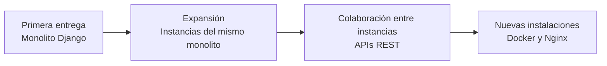

# LogiX: evolución de una plataforma crítica de distribución logística

> Este documento describe decisiones de ingeniería y su razonamiento. No detalla topología de producción, configuración de infraestructura, reglas completas de negocio ni estructuras de datos, por confidencialidad y seguridad.

## En breve

| Aspecto | Contexto |
|---|---|
| **Rol** | Liderazgo técnico del desarrollo inicial y responsabilidad continuada sobre el producto en producción |
| **Problema** | Bloqueos operativos e inconsistencias en la distribución, con dependencia obligatoria del ERP |
| **Decisión inicial** | Monolito Django sobre tecnología conocida para entregar con un equipo pequeño |
| **Evolución** | Instancias independientes comunicadas por APIs REST, despliegues contenerizados para nuevas instalaciones y adaptación de reglas por operación |
| **Escala actual** | Procesos de distribución para 3 centros y 24 tiendas |
| **Límite principal** | Dependencia de la disponibilidad y del comportamiento del ERP; la sincronización independiente sigue siendo una alternativa no implementada |

Las mejoras de tiempo que se mencionan más adelante son **mediciones de la primera entrega**, no métricas actuales garantizadas. El sistema sigue en evolución y conserva deuda técnica conocida.

---

## Contexto

Una operación de retail donde la distribución de mercancía es un proceso crítico: si un centro de distribución se detiene, las tiendas no reciben producto y la capacidad de venta se ve comprometida de forma directa.

El ERP corporativo (Siesa) actúa como fuente de verdad para inventario, compras y requisiciones. Cualquier sistema logístico tiene que reportarle, y su disponibilidad no está bajo control del equipo de desarrollo.

Lideré la reconstrucción del sistema de distribución y mantengo su ownership técnico desde entonces. Eso significa que las decisiones que describo aquí no son hipótesis: he visto sus consecuencias en producción a lo largo de más de un año de evolución.

---

## El sistema heredado

El sistema anterior había sido construido para resolver una necesidad puntual, no una proyección del negocio. Acumulaba problemas de seguridad, mantenibilidad, confiabilidad de datos, productividad y experiencia de usuario, y era difícil de evolucionar.

Técnicamente, la lógica de negocio vivía repartida entre la capa de presentación y la base de datos, sin una capa de aplicación que la centralizara. Parte del stack estaba descontinuado.

### Los problemas concretos

**Confiabilidad de los datos.** El sistema y el ERP reportaban información distinta sobre los mismos hechos. No existía forma confiable de saber cuál tenía razón, lo que obligaba a verificaciones manuales y reprocesos.

**Bloqueo de la operación.** Los procesos de importación bloqueaban el acceso a la información durante varios minutos y debían ejecutarse varias veces al día, porque las requisiciones se anulaban y regeneraban durante la jornada. Cada ejecución detenía la operación.

**Despacho secuencial.** Sincronizar cada unidad de carga con el ERP requería dos operaciones por cada requisición contenida, ejecutadas en serie. A unos diez segundos por operación, una unidad con diez requisiciones implicaba veinte operaciones consecutivas: alrededor de tres minutos. Cuando el ERP se degradaba y cada operación superaba el minuto, ese tiempo escalaba hasta los veinte minutos por unidad.

El costo real para el negocio no era la lentitud del software. Era tener operarios detenidos esperando.

---

## Restricciones del proyecto

- **Tiempo.** La operación sufría a diario. No había margen para un proyecto largo.
- **Equipo.** Dos personas, ambas manteniendo otros sistemas en paralelo.
- **Dependencia del ERP.** Obligatoria, y sin control sobre su disponibilidad.
- **Gobernanza técnica.** Las decisiones de stack requerían aprobación fuera del equipo de desarrollo.
- **Riesgo de adopción.** Introducir tecnologías que el equipo no dominara aumentaba el riesgo de no entregar.

---

## Alternativas evaluadas

### Parchar el sistema existente

`Descartada`

Corregir los problemas de confiabilidad implicaba reescribir la lógica de negocio de todas formas, y esa lógica estaba dispersa entre presentación y base de datos, sin una capa donde intervenir de forma centralizada. El esfuerzo se acercaba al de reconstruir, con la diferencia de que el resultado seguiría siendo inmantenible.

### Arquitectura desacoplada con sincronización independiente

`Descartada`

Era la alternativa que yo consideraba más adecuada: que el sistema operara sobre su propio estado y que un componente independiente gestionara la sincronización con el ERP de forma asíncrona.

Implementarla correctamente exigía resolver persistencia de estados, reintentos, reconciliación de resultados ambiguos, idempotencia, control de concurrencia y recuperación ante indisponibilidad del sistema externo. Con dos desarrolladores a tiempo parcial y presión operativa inmediata, esa complejidad excedía lo que el proyecto podía absorber en el plazo disponible.

### Monolito Django acoplado al ERP

`Implementada`

Un sistema vertical que mantiene la dependencia del ERP pero rediseña los procesos y las integraciones que causaban los problemas.

Elegí Django porque era la tecnología que el equipo ya dominaba. Cualquier alternativa implicaba aprender mientras entregábamos. El stack inicial fue Python 3, Django, PostgreSQL, JavaScript, HTML/CSS y Bootstrap, con SQL Server para determinadas consultas e integraciones contra el ERP.

Una crítica válida al resultado es que el sistema no quedó reactivo, algo que otro stack habría facilitado. La prioridad, sin embargo, era la productividad de la operación, no la interfaz.

> **Trade-off inicial:** una solución entregada dentro del plazo que la operación necesitaba, a cambio de mantener la dependencia del ERP y una resiliencia limitada ante su indisponibilidad.

---

## Decisiones de ingeniería de la primera versión

### Concurrencia en la sincronización

Ataqué el bloqueo procesando la importación de datos de forma concurrente en lugar de secuencial, reduciendo las ventanas en que la operación quedaba detenida.

El ERP aceptaba operaciones simultáneas, y ese comportamiento fue una premisa de diseño durante toda la construcción del sistema. Más adelante ese supuesto dejó de cumplirse.

### Idempotencia en operaciones críticas

Diseñé las operaciones de sincronización para poder reintentarse sin duplicar transacciones. Era indispensable: la solución debía tolerar indisponibilidad y tiempos de respuesta variables del ERP, y sin idempotencia cada interrupción introducía riesgo de duplicidad en los datos de inventario.

### Control de concurrencia sobre compromisos de mercancía

Durante el desarrollo identifiqué que el sistema anterior no distinguía adecuadamente el compromiso de mercancía de su despacho en operaciones parciales. Esa diferencia podía producir inconsistencias entre cargas.

Introduje controles de estado y concurrencia para coordinar esas operaciones y evitar el patrón de inconsistencias detectado, sin depender de verificaciones manuales entre cargas.

### Modelo de datos e integraciones

Diseñé el modelo de datos y las integraciones, condicionado por la necesidad de mantener correspondencia con las estructuras del ERP. Esa decisión tuvo consecuencias que aparecen más adelante en este documento.

### Despliegue

Desplegué sobre Ubuntu Server con Gunicorn y Apache2, como instalación directa sobre el sistema operativo. Para el alcance de ese momento —una operación principal, pocas instalaciones, infraestructura conocida— era la estrategia adecuada.

**Resultados de la primera entrega (agosto de 2025):** la importación de datos pasó de unos cinco minutos a unos tres segundos; el despacho promedio de una unidad de carga, de unos tres minutos a unos diez segundos; y desaparecieron las inconsistencias entre cargas descritas anteriormente. Estas mediciones corresponden a la primera entrega, no necesariamente al rendimiento actual tras cambios posteriores en el ERP.

---

## De proyecto a producto

La primera entrega no cerró el proyecto: seguí corrigiendo incidentes, mejorando procesos y refactorizando componentes con usuarios reales. Esa continuidad permitió evaluar las decisiones iniciales por sus consecuencias en producción.

---

## Cuando cambia el comportamiento de una dependencia externa

Una de las situaciones más instructivas surgió de un comportamiento externo que LogiX no controlaba.

LogiX se diseñó y se construyó sobre un supuesto verificado: el ERP aceptaba operaciones simultáneas. La concurrencia en la sincronización era una de las razones por las que el sistema había recuperado la productividad de la operación.

Un día, sin aviso ni despliegue de nuestro lado, la integración empezó a devolver errores de *deadlock* y de documento ya existente, compatibles con una pérdida de tolerancia a las operaciones concurrentes. No hubo cambios en LogiX ese día ni en los anteriores. Sin acceso al código y la configuración internos del ERP, no fue posible verificar la causa exacta del cambio de comportamiento.

Escalamos el caso con el equipo responsable del ERP. No fue posible confirmar desde nuestro entorno la causa exacta del cambio observado, de modo que la solución debía contemplar el comportamiento que presentaba la integración.

**La única salida era adaptar LogiX.** Tuvimos que reducir la concurrencia contra el ERP y ajustar la operación a una restricción que no existía cuando el sistema fue diseñado, sacrificando parte del rendimiento que se había ganado.

Lo que aprendí de esto no fue solo sobre concurrencia. Fue sobre acoplamiento: **cuando un sistema depende del comportamiento de otro que no controlas, dependes tanto de su disponibilidad como de la estabilidad de su comportamiento.** Un supuesto verificado durante el diseño puede dejar de cumplirse, independientemente de que se conozca la causa.

El episodio refuerza el valor de la alternativa desacoplada que había propuesto al inicio. Una capa de sincronización independiente, **si incorpora límites de concurrencia configurables**, habría permitido aislar mejor la adaptación al destino y evitar cambios en los flujos de atención a usuarios. No habría eliminado, por sí sola, los errores ni la necesidad de reconciliar transacciones.

---

## Cuando el alcance original llegó a su límite

LogiX se había construido pensando en una operación principal. Cuando fue necesario soportar un segundo centro de distribución, apareció un límite del diseño: **el sistema no era multitenant, ni había sido concebido para múltiples centros independientes.**

Había dos caminos. Convertir LogiX en multitenant implicaba una modificación profunda de un sistema que ya estaba en producción sosteniendo una operación crítica. Mantener instancias independientes evitaba esa reescritura pero introducía un problema distinto.

Elegí el modelo de instancias independientes. El nuevo centro recibió la suya.

### El problema que eso trasladaba al usuario

Si los puntos de venta tuvieran que trabajar directamente contra cada centro, los usuarios tendrían que saber qué centro usar, cambiar de aplicación, iniciar sesiones distintas y modificar su flujo según el destino. Eso convertía una decisión de arquitectura en carga cognitiva para el operario.

La solución fue extender el modelo: además de las instancias de los centros, configuré instancias asociadas a los puntos de venta, de modo que cada usuario trabajara sobre su propia instancia conservando su contexto operacional.

### Comunicación entre instalaciones

Para que esas instalaciones pudieran colaborar, incorporé Django REST Framework y LogiX empezó a exponer APIs REST.

El valor de esa decisión no fue adoptar una tecnología, sino **desacoplar la interacción del usuario de la ubicación física de la operación con la que trabaja**. El usuario sigue en su instancia; LogiX se encarga de la comunicación entre sistemas.

### Una precisión que importa

Esto **no fue una migración a microservicios**. Cada instancia de LogiX sigue siendo la misma aplicación monolítica que se construyó al principio. Lo que cambió fue la arquitectura del sistema completo y la estrategia de despliegue.

La descripción técnicamente correcta es **un monolito desplegado de forma distribuida**: un conjunto de instancias independientes de una misma aplicación, capaces de comunicarse entre sí.

---

## Evolución de la estrategia de despliegue

Con muchas más instalaciones, administrarlas directamente sobre el sistema operativo habría complicado el aislamiento, las dependencias, la configuración, los despliegues, el mantenimiento y cualquier migración futura.

Adopté Docker y Nginx **para las instancias nuevas**. Buscaba aislamiento, reproducibilidad, facilidad de despliegue y mantenimiento, y portabilidad entre servidores.

El cambio conceptual: antes, una instalación estaba fuertemente ligada al servidor donde se había configurado; después, una instancia podía empaquetarse y administrarse con relativa independencia del host que la ejecuta.

Eso permitió algo deliberado: **varias instancias podían compartir infraestructura al inicio, con la posibilidad de separarlas después si alguna lo necesitaba.** La contenerización no se adoptó porque cada instancia tuviera su propio servidor, sino precisamente para no tener que decidir eso desde el primer día.

### Transición y beneficios

La adopción fue progresiva: coexistieron instalaciones directas en Ubuntu Server con Apache2 e instancias nuevas en Docker con Nginx. No se reescribió toda la infraestructura por uniformidad tecnológica.

La contenerización ya facilita el aislamiento y despliegues reproducibles en infraestructura compartida. También permitiría trasladar instancias a servidores dedicados, pero **esa migración aún no se ha ejecutado**.

### Evolución de la solución

*Esquema de evolución tecnológica, no de la topología de producción. La transición a contenedores fue progresiva.*

---

## Adaptación a operaciones distintas

Incorporar un tercer centro con características operativas diferentes reveló un problema conceptual más interesante que cualquier requerimiento nuevo:

**Varias reglas que parecían formar parte general del dominio resultaron ser específicas de la forma de operar del primer centro.**

Mientras solo existió una operación, esa distinción era invisible. Un segundo contexto la hizo evidente y obligó a separar lo general de lo particular.

La alternativa fácil habría sido duplicar la base de código. En lugar de eso refactoricé los módulos afectados e introduje mecanismos de configuración, de modo que el mismo producto pudiera adaptar determinados comportamientos según el contexto operacional en el que se despliega.

Ese trabajo incluyó también la generación de órdenes de compra y requisiciones desde LogiX, y su envío hacia el ERP.

---

## Mayor responsabilidad dentro del dominio

La adaptación anterior produjo un cambio de fondo en la relación entre LogiX y el ERP.

Originalmente LogiX consultaba, importaba y consumía información originada en el ERP. Con esta evolución empezó también a generar determinados documentos, originar operaciones y enviarlas hacia él.

LogiX no reemplaza al ERP: Siesa sigue siendo la fuente de verdad corporativa. Pero dejó de ser únicamente una capa operacional consumidora.

### Distribución basada en lo realmente recibido

El cambio funcional más significativo del producto surgió de una diferencia que la operación conocía pero el sistema no modelaba.

LogiX importaba del ERP requisiciones construidas sobre cantidades planificadas. La realidad podía diferir: un proveedor con una cantidad solicitada podía entregar menos. Entre lo solicitado, lo efectivamente recibido y lo realmente disponible para distribuir había diferencias, y resolverlas quedaba en manos del operario durante la preparación de pedidos.

Modifiqué ese enfoque para que LogiX generara directamente parte de las necesidades de distribución tomando como base la información de mercancía efectivamente recibida.

El efecto fue reducir decisiones manuales durante el picking y permitir que la distribución respondiera a la disponibilidad real en lugar de a una planificación previa.

### Menos interacción directa con el ERP

Más recientemente incorporé la capacidad de ejecutar desde LogiX el recibo de determinados documentos provenientes de los centros, un proceso que antes obligaba a los puntos de venta a trabajar directamente sobre el ERP.

Esto continúa una tendencia del producto: **LogiX ha ido encapsulando progresivamente la complejidad de interacción con el ERP**, funcionando cada vez más como la capa operacional especializada en procesos logísticos.

---

## Integraciones externas

Durante la evolución del producto incorporé una integración B2B para intercambiar información logística, incluidos avisos de despacho, mediante transferencia de archivos por SFTP.

---

## Observabilidad de la integración con el ERP

En septiembre de 2026 implementé un tablero en **Grafana** para observar la salud de las integraciones entre LogiX y Siesa. El tablero utiliza información de los registros de integración consultada con permisos restringidos de lectura, sin ejecutar transacciones de negocio.

Sus paneles permiten analizar volumen de solicitudes, solicitudes sin respuesta, proporciones por tipo de documento y latencias. También se utilizó como evidencia técnica en conversaciones con el proveedor del ERP sobre el comportamiento observado desde LogiX.

No es un mecanismo que resuelva por sí solo las fallas del sistema externo: **su aporte es hacer visibles y contrastables los síntomas**, facilitar el diagnóstico y mejorar la comunicación entre los equipos responsables.

---

## Resultados

- Sustitución del sistema heredado y resolución de los principales problemas de bloqueo operativo y confiabilidad identificados, aunque la nueva plataforma conserva limitaciones y deuda técnica propias.
- En la primera entrega, reducción de la importación de datos de unos cinco minutos a unos tres segundos y del despacho promedio de una unidad de carga de unos tres minutos a unos diez segundos. Son cifras históricas: después hubo que reducir la concurrencia hacia el ERP, sacrificando parte del rendimiento obtenido.
- Corrección de las inconsistencias entre cargas parciales que se habían identificado en el sistema anterior, evitando ese patrón específico de errores.
- Expansión desde una operación principal hasta soportar procesos de distribución en **3 centros de distribución y 24 tiendas**.
- Evolución de una instalación única a un modelo de instancias independientes que se comunican mediante APIs REST.
- Adopción progresiva de contenedores para nuevas instancias, con beneficios de aislamiento y administración ya observados y una eventual migración a infraestructura dedicada todavía pendiente.
- Soporte de contextos operativos distintos sobre una misma base de código, mediante refactorización y configuración, sin duplicar el producto.
- Incorporación de una integración logística externa, además del ERP, y de un tablero de observabilidad de las operaciones de integración mediante Grafana.
- Reducción de tareas manuales y de la necesidad de que usuarios operativos interactúen directamente con el ERP.
- Capacidad de originar determinadas operaciones del dominio, no solo consumirlas.
- Continuidad de la operación ante un cambio no anunciado en el comportamiento del sistema externo, mediante adaptación del propio sistema.
- Sistema en producción y en evolución continua bajo mi ownership.

---

## Límites actuales y deuda conocida

**Dependencia de la disponibilidad del ERP.** La indisponibilidad del sistema externo afecta procesos operativos que necesitan intercambiar información con él; el producto no dispone todavía de una estrategia de sincronización totalmente autónoma.

**Dependencia del comportamiento del ERP.** Más allá de su disponibilidad, LogiX depende de que las reglas del sistema externo no cambien. Ya ocurrió una vez con la tolerancia a operaciones concurrentes, y la adaptación tuvo que hacerse del lado de LogiX y de la operación.

**Transacciones en estado ambiguo.** Una comunicación interrumpida con el ERP no siempre permite determinar si la operación se completó en el sistema externo. Esto exige mecanismos de verificación y reconciliación.

**Acoplamiento de la sincronización.** La ejecución de operaciones de integración no quedó aislada mediante un componente independiente con control de flujo configurable. Esta decisión dificultó adaptarse al cambio de comportamiento observado en el ERP.

**Acoplamiento en el modelo de datos.** La identidad de determinadas entidades quedó ligada a la que asigna el ERP. Cuando LogiX empezó a originar información propia, esa decisión exigió mecanismos adicionales de correspondencia entre ambos sistemas.

**Alcance evolutivo.** Algunas funcionalidades adicionales de apoyo operativo se diseñaron, pero no se implementaron debido a las prioridades y al tiempo disponible.

---

## Qué habría hecho diferente

No sostengo que lo siguiente sea objetivamente correcto. Son las decisiones que tomaría hoy, con el criterio que me dio mantener este sistema en producción.

### Operación local primero, sincronización en segundo plano

**Qué haría:** que el sistema opere de forma autónoma sobre sus propios datos, con un componente sincronizador que gestione la comunicación con el ERP en segundo plano, con reintentos y control de estado.

**Por qué:** la disponibilidad de un sistema no debería depender de otro sobre el que no se tiene control. La distribución tiene que poder continuar aunque el ERP no responda; la sincronización importa, pero no tiene por qué ser inmediata.

La evidencia acumulada respalda el criterio: las transacciones en estado ambiguo que hoy requieren intervención manual son exactamente el tipo de caso que un sincronizador con control de estado podría reconciliar automáticamente.

**El contra-argumento, que reconozco:** implica consistencia eventual y resolución de conflictos, complejidad real y no gratuita para un equipo pequeño. Esa fue precisamente la razón de descartarla al inicio, y seguiría siendo un factor.

### Ejecución desacoplada del trabajo de sincronización

**Qué haría:** mover las operaciones de sincronización a workers con una cola y control explícito de concurrencia, fuera del proceso que atiende a los usuarios.

**Por qué:** el trabajo que depende de un sistema externo debería poder regularse sin acoplar su ritmo al procesamiento de solicitudes de usuarios. De ese modo se podría controlar la presión sobre el ERP y aislar mejor sus degradaciones.

Una cola aporta además algo que este caso demostró con claridad: **el nivel de concurrencia hacia un destino externo debería ser un parámetro, no una característica del código.** Cuando el ERP dejó de aceptar operaciones simultáneas, adaptarse significó modificar el comportamiento del sistema. Con control de flujo explícito, habría significado cambiar un valor.

Como nota secundaria: el cuello de botella es de I/O, no de CPU, así que el problema principal es el acoplamiento de la ejecución y no el GIL de Python.

### Identidad propia en el modelo de datos

**Qué haría:** que cada entidad tenga su propio identificador y que el del sistema externo sea un atributo más.

**Por qué:** la identidad de una entidad pertenece al sistema que la modela, no a la fuente desde la que llegó.

Esta decisión simplificó inicialmente la correspondencia con el ERP. Su costo apareció cuando LogiX empezó a originar registros propios: hubo que introducir mecanismos adicionales de asociación entre las entidades locales y las externas. Una identidad local independiente habría facilitado esa evolución sin perder la referencia al sistema corporativo.

### Lo que no cambiaría

**La contenerización.** Añadió complejidad operacional, pero ya facilita el aislamiento y la administración de varias instancias. La portabilidad fue otro objetivo: simplificar una eventual migración a infraestructura dedicada, que todavía no se ha ejecutado.

**El monolito.** Con dos personas, tiempo parcial y presión operativa, un monolito sobre tecnología conocida fue lo que permitió entregar y sostener el sistema. El crecimiento posterior no se resolvió reescribiéndolo, sino cambiando cómo se despliega.

---

## Reflexión

La arquitectura inicial resolvió correctamente el problema que existía bajo las restricciones de ese momento. LogiX terminó creciendo mucho más allá del alcance para el que fue concebido.

Varias de sus limitaciones actuales son consecuencias conocidas de decisiones que fueron razonables en su contexto. Otras decisiones, tomadas pensando en flexibilidad futura, terminaron produciendo beneficios que en su momento eran solo una apuesta. Y algunas restricciones no vinieron de decisiones propias en absoluto, sino de una dependencia externa cuyo comportamiento observado cambió sin que pudiera verificarse la causa exacta.

Haber mantenido el ownership durante toda esa evolución me permitió ver las dos caras de esas decisiones: el beneficio inmediato que hicieron posible y el costo —o el beneficio adicional— que apareció cuando el sistema tuvo que crecer.

---

[← Volver al portafolio](./README.md)
