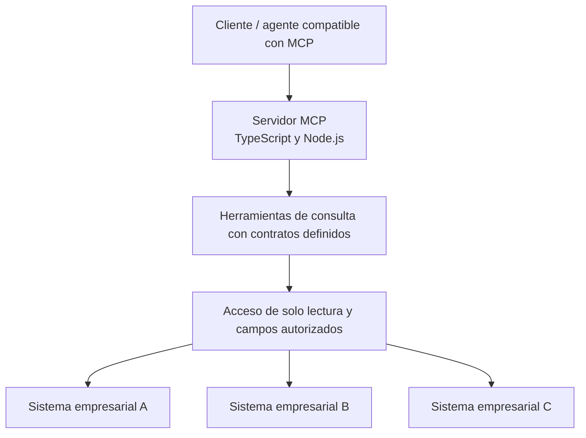

# MCP interno: herramientas seguras para agentes sobre sistemas empresariales

> Este caso de estudio describe una implementación productiva de herramientas para agentes basada en Model Context Protocol (MCP). El código, las credenciales y las configuraciones de acceso son internos; aquí documento el problema, las decisiones de ingeniería, los resultados validados y sus límites, sin exponer información sensible.

---

## Contexto y problema

En una operación empresarial, una incidencia de soporte puede involucrar datos repartidos entre varias aplicaciones. Para determinar por qué un proveedor no podía acceder a un portal, por qué una orden de compra no avanzaba o qué citas estaban registradas, el equipo debía consultar distintos sistemas de forma manual.

No bastaba con encontrar un registro. Había que relacionar entidades y comprender los prerrequisitos entre procesos: la existencia de un tercero no implica que esté configurado como proveedor, que tenga una cuenta habilitada o que exista en los portales asociados.

La calidad y velocidad del diagnóstico dependían de conocer **qué consultar, en qué orden y cómo interpretar resultados de diferentes fuentes**. Ese conocimiento operativo no estaba disponible de forma uniforme para todas las personas que atendían las incidencias.

## Objetivo

Construir una interfaz uniforme de herramientas que permitiera a agentes de IA consultar y correlacionar información de varios sistemas empresariales, sin proporcionar a esos agentes credenciales de las bases de datos ni acceso indiscriminado a los sistemas.

La meta era apoyar el diagnóstico de soporte con información verificable. **No se trataba de construir un modelo de IA ni un agente autónomo propio**: los clientes compatibles con MCP aportan el razonamiento y la elección de herramientas; el servidor desarrollado por mí define qué consultas están disponibles y bajo qué restricciones.

## Alcance y estado

El proyecto comenzó en septiembre de 2026. La base funcional está desplegada y ha sido utilizada internamente por mí y por otros integrantes del equipo.

La implementación actual integra **tres sistemas empresariales**:

1. Una fuente de información maestra sobre terceros, proveedores y usuarios asociados.
2. Un portal de autogestión, con información de cuentas y trazabilidad de operaciones de compra.
3. Un portal de citas, con datos de usuarios y programación de entregas de proveedores.

La primera versión integraba las dos primeras fuentes. El tercer sistema se incorporó cuando los tickets reales evidenciaron que el diagnóstico de acceso y citas exigía reconstruir una cadena más completa.

## Diseño de la solución

### Backend e integración

Desarrollé el servidor en **TypeScript sobre Node.js**, utilizando **MCP** para exponer herramientas de consulta con contratos definidos y **Zod** para validar esquemas. Se publica mediante **Streamable HTTP** y se ejecuta en **Docker** dentro del entorno interno de la empresa.

El servidor se configuró en distintos clientes compatibles con MCP y en equipos de compañeros. Esta validación permitió comprobar que las herramientas no dependían de un solo cliente ni de una configuración de uso personal.

La arquitectura conceptual es:

El diagrama es intencionalmente conceptual: no representa la topología de producción ni los mecanismos internos de conexión.

### Seguridad como restricción de diseño

La decisión más importante fue **no entregar a los agentes acceso general a las bases de datos**.

Cada fuente utiliza una cuenta independiente de PostgreSQL con permisos mínimos, exclusivamente de lectura y restringidos a los datos autorizados. Los permisos se aplican en la capa de datos, no únicamente mediante instrucciones al agente.

Esto establece dos límites complementarios:

- **La herramienta:** ofrece operaciones concretas para recuperar información útil de soporte, en lugar de exponer consultas arbitrarias sobre todos los datos.
- **La fuente:** restringe los registros y campos accesibles, de modo que una herramienta no puede recuperar información para la que su cuenta no tenga permisos.

El servicio exige además autenticación para los clientes autorizados. No se publican tokens, credenciales, direcciones internas ni estructuras de acceso.

Una prueba explícita consistió en pedir credenciales de un usuario: el agente podía obtener el identificador permitido, pero **no la contraseña**, porque ese dato no estaba disponible mediante los permisos concedidos. La recuperación de acceso debía continuar por los canales establecidos del equipo de soporte.

Este comportamiento es relevante en aplicaciones con agentes: una respuesta generada por un modelo no constituye una política de autorización. El control debe existir en los servicios y fuentes de datos.

## Casos validados con incidencias reales

### 1. Verificación de cuentas antes de crear duplicados

Ante solicitudes de creación o recuperación de usuarios, los agentes conectados pudieron verificar si el tercero existía, si tenía configurado su perfil de proveedor y si había cuentas en los sistemas correspondientes.

En algunos casos se encontró que la cuenta ya estaba creada y activa. El diagnóstico permitió identificar esa situación **antes de iniciar un alta duplicada**.

La herramienta no creó ni modificó usuarios: proporcionó información para orientar el procedimiento de soporte.

### 2. Reconstrucción de dependencias entre sistemas

Un ticket solicitaba acceso para un proveedor que aún no tenía completada su configuración en los distintos portales.

La consulta multi-sistema mostró que el tercero existía como entidad maestra, pero faltaban configuraciones y cuentas necesarias en otras aplicaciones. En lugar de responder solamente «el usuario no existe», el agente pudo ordenar los prerrequisitos: primero la configuración comercial del proveedor y después la creación o habilitación de los accesos que dependen de ella.

**El valor no fue una consulta individual**, sino combinar información de fuentes distintas para reconstruir un flujo operativo que antes dependía del conocimiento implícito del equipo.

### 3. Información contradictoria o insuficiente

Durante una verificación se detectó que un identificador de proveedor no coincidía con el dato proporcionado en la solicitud. En lugar de continuar con una coincidencia parcial, el agente pidió confirmar la identidad.

En otra incidencia, el estado de una orden aparecía como pendiente. Ese estado por sí solo no demostraba la causa. Para revisar la trazabilidad, el agente solicitó los identificadores y la referencia temporal necesarios para consultar los registros disponibles.

También hubo solicitudes ambiguas de parametrización. Cuando los datos consultables no permitían inferir con seguridad una regla de negocio, el agente no debía presentar esa regla como existente.

Estos casos muestran por qué **ausencia de datos, configuración incompleta, discrepancia de identidad y fallo de integración** no son diagnósticos equivalentes.

### 4. Consultas operativas sobre citas

Tras incorporar la tercera fuente, las herramientas permitieron realizar consultas de citas confirmadas en intervalos horarios y consolidar información operativa relevante, como proveedor, hora, órdenes relacionadas y cantidades registradas.

También fue posible distinguir registros asociados a distintos portafolios de un mismo proveedor, en lugar de asumir que una coincidencia de nombre implicaba una única entidad válida.

## Resultados demostrados

- **Tres sistemas integrados** detrás de una interfaz de herramientas compatible con MCP.
- **Servidor backend en TypeScript/Node.js**, desplegado con Docker y disponible para uso interno.
- **Uso por otros integrantes del equipo** desde clientes compatibles, no solamente en el entorno de desarrollo original.
- **Diagnósticos validados con tickets reales:** identificación de cuentas existentes, prerrequisitos faltantes, diferencias de identidad y necesidad de obtener evidencia adicional antes de atribuir causas.
- **Acceso acotado por diseño:** cuentas independientes de solo lectura y restricción de campos sensibles desde las fuentes.

No atribuyo al proyecto cifras de ahorro de tiempo, reducción de tickets ni mejoras de productividad que no se hayan medido. El resultado comprobado es su funcionamiento y utilidad para los escenarios operativos documentados.

## Límites actuales y evolución prevista

**Solo lectura.** El servidor permite consultar información, pero no ejecuta altas, habilitaciones ni actualizaciones de datos empresariales. Las acciones sensibles siguen los procedimientos habituales de soporte.

**Cobertura delimitada.** Las herramientas sirven para los datos y procesos que exponen sus contratos. No pueden responder de manera fiable preguntas sobre campos o reglas que no estén representados en las fuentes disponibles.

**Dependencia de los sistemas de origen.** La calidad del diagnóstico depende de la información que esas aplicaciones registran y permiten consultar. Un agente no debe interpretar información ausente como prueba de una causa concreta.

**Evolución futura, no implementada.** Existe la intención de añadir operaciones específicas de escritura, por ejemplo habilitar usuarios mediante herramientas con permisos acotados. Esa capacidad **no forma parte de la versión actual** y requeriría controles apropiados antes de habilitarse.

## Reflexión de ingeniería

La parte más importante de este proyecto no fue conectar un asistente con una base de datos. Fue **convertir conocimiento operativo disperso en capacidades reutilizables**, con contratos explícitos y límites de autorización verificables.

El diseño separa tres responsabilidades: los sistemas empresariales mantienen sus datos y permisos; el servidor MCP expone únicamente capacidades autorizadas; y el cliente agente interpreta la solicitud y utiliza las herramientas disponibles para construir un diagnóstico.

Esta separación permite incorporar nuevas fuentes sin distribuir credenciales a cada cliente y obliga a distinguir lo que una herramienta puede demostrar de lo que un agente solo puede inferir.

Es una aplicación de ingeniería de integración y seguridad al desarrollo de herramientas para agentes: el razonamiento del modelo amplía la utilidad de los datos, pero **no amplía sus privilegios**.
