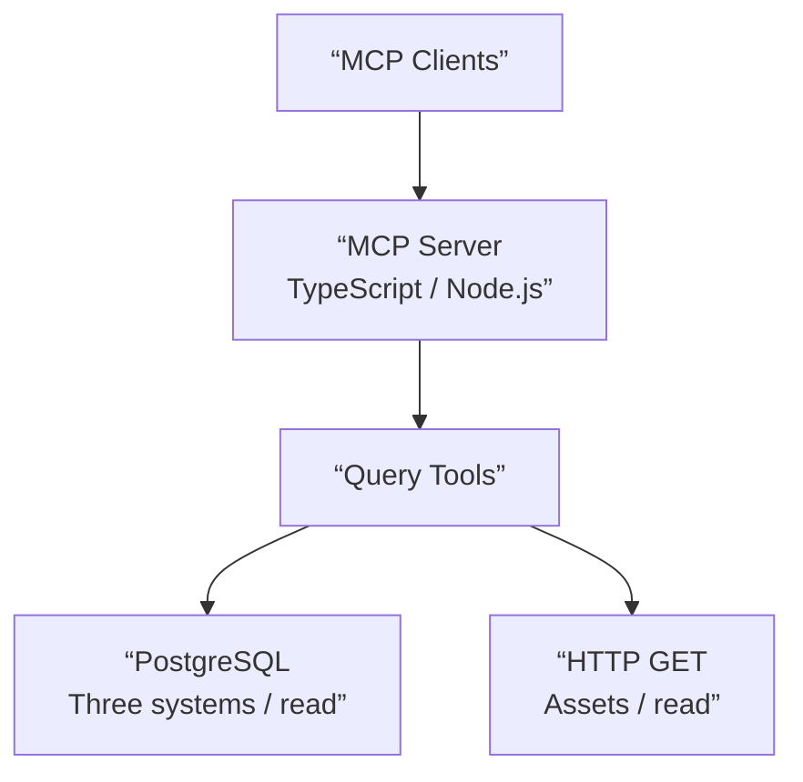

# Internal MCP: Secure Agent Tools for Enterprise Systems

> This case study describes a production deployment of agent tools based on the Model Context Protocol (MCP). The code, credentials, and access configurations are internal; here I document the problem, the engineering decisions, the validated results, and their limitations, without disclosing sensitive information.

---

## Context and Problem

In a business operation, a support incident may involve data spread across multiple applications. To determine why a vendor could not access a portal, why a purchase order was not moving forward, or which appointments were scheduled, the team had to manually check different systems.

Simply finding a record was not enough. It was necessary to link entities and understand the prerequisites between processes: the existence of a third party does not imply that it is configured as a vendor, that it has an active account, or that it exists in the associated portals.

The quality and speed of the diagnosis depended on knowing **what to check, in what order, and how to interpret results from different sources**. That operational knowledge was not uniformly available to everyone handling the support cases.

## Objective

To build a unified tool interface that would allow AI agents to query and correlate information from various enterprise systems, without providing those agents with direct credentials or unrestricted access to the systems.

The goal was to support troubleshooting with verifiable information. **This was not about building an AI model or a standalone autonomous agent**: MCP-compatible clients provide the reasoning and tool selection; the server I developed defines which queries are available and under what restrictions.

## Scope and Status

The project began in September 2026. The functional foundation is in place and has been used internally by me and other team members.

The current implementation integrates **four business systems**:

1. A master data source for third parties, suppliers, and associated users.
2. A self-service portal with account information and traceability of purchase transactions.
3. A supplier appointment scheduling application that also maintains a historical fixed-asset module, including purchase invoices and asset transfers.
4. A current asset management application containing maintenance records, asset transfers, deliveries, and other operational records, integrated via an HTTP service.

The first version integrated the first two sources, and the scheduling source was added later. In October 2026, I expanded the tools of that **same source** to query historical assets and added a **fourth source** via HTTP. Enabling the historical module does not in itself require additional enterprise integration.

## Solution Design

### Backend and Integration

I developed the server in **TypeScript on Node.js**, using **MCP** to expose query tools with defined contracts and **Zod** to validate schemas. It is published via **Streamable HTTP** and runs in **Docker** within the company’s internal environment.

The server was configured on various MCP-compatible clients and on colleagues’ computers. This validation confirmed that the tools did not depend on a single client or on a personal configuration.

The expansion introduced a second integration mechanism without changing the interface used by clients:

- **PostgreSQL:** separate read-only accounts with minimal permissions for the three previously connected systems.
- **HTTP:** `GET` requests authenticated using a Bearer token granted by the active asset application with read permissions. The token remains on the service side; it is not delivered to agents.

### Conceptual view of the integration

*Logical diagram; does not represent directions, topology, or production configuration.*

### Security as a Design Constraint

> **Security Principle:** Do not grant agents general access to business systems or direct credentials.

PostgreSQL sources use separate accounts with minimal read permissions and restrictions on the available data. In the HTTP integration, the source system granted a Bearer token with read permissions for the `GET` endpoints used. **These are not equivalent authorization mechanisms:** the restrictions of a PostgreSQL account should not be automatically applied to an HTTP API.

This establishes two complementary controls:

- **The tool:** exposes specific query operations rather than allowing arbitrary queries or general modifications.
- **The source:** applies the authorization corresponding to its access mechanism, whether PostgreSQL or HTTP.

The service also requires authentication for authorized clients. Tokens, credentials, internal addresses, and access structures are not published. MCP client authentication does not, by itself, demonstrate individual authorization over all assets; that scope must be evaluated on a per-tool and per-source-system basis.

One explicit test involved requesting a user’s credentials: the agent could obtain the authorized identifier, but **not the password**, because that information was not available under the granted permissions. Access recovery had to proceed through the support team’s established channels.

This behavior is relevant in applications with agents: a response generated by a model does not constitute an authorization policy. Control must reside within the services and data sources.

## Cases Validated with Real Incidents

### 1. Account Verification Before Creating Duplicates

When processing requests to create or recover user accounts, connected agents were able to verify whether the third party existed, whether their provider profile was configured, and whether accounts existed in the corresponding systems.

In some cases, it was found that the account had already been created and was active. The diagnostic process made it possible to identify this situation **before initiating a duplicate registration**.

The tool did not create or modify users: it provided information to guide the support process.

### 2. Reconstructing Dependencies Between Systems

A support ticket requested access for a vendor whose configuration had not yet been completed across the various portals.

The cross-system query showed that the third party existed as a master entity, but necessary configurations and accounts were missing in other applications. Instead of simply responding, “The user does not exist,” the agent was able to prioritize the prerequisites: first, the vendor’s business configuration, and then the creation or activation of the accesses that depend on it.

**The value lay not in a single query**, but in combining information from different sources to reconstruct an operational workflow that previously depended on the team’s tacit knowledge.

### 3. Contradictory or Insufficient Information

During a verification, it was detected that a vendor identifier did not match the information provided in the request. Instead of proceeding with a partial match, the agent asked for confirmation of the identity.

In another incident, the status of an order appeared as “pending.” That status alone did not indicate the cause. To review the traceability, the agent requested the identifiers and timestamp necessary to consult the available records.

There were also ambiguous requests for parameterization. When the available data did not allow for the reliable inference of a business rule, the agent should not have presented that rule as existing.

These cases demonstrate why **lack of data, incomplete configuration, identity discrepancy, and integration failure** are not equivalent diagnoses.

### 4. Operational Queries Regarding Appointments

After incorporating the third data source, the tools made it possible to query confirmed appointments by time intervals and consolidate relevant operational information, such as provider, time, related orders, and recorded quantities.

It was also possible to distinguish records associated with different portfolios of the same provider, rather than assuming that a name match implied a single valid entity.

### 5. Fixed Asset Traceability Across Legacy and Current Applications

The need arose from a teammate: to track the history of a fixed asset, he had to check three different applications, without necessarily knowing which ones contained the relevant records. This fragmented search made it difficult to distinguish between the acquisition, transfers, and maintenance activities for a single asset.

**Reusing an existing integration.** The application already connected for appointment inquiries includes a fixed asset module that currently serves as a historical database. I added tools to view the assets, their acquisition data, invoices, and movements between origin and destination locations. The expansion leveraged the existing connection and did not require adding another business source.

**Tests conducted with agents:**

- Searching for an asset by identifier and retrieving its descriptive and acquisition data from the historical system.
- Viewing its transfers and an organized display of movements showing origin, destination, and date.
- Querying both sources to link records for the same asset or determine which source contained a record that was missing from the other.

The tests showed that **a historical transfer does not necessarily confirm the current location or custody**. Likewise, the fact that a search yields no records in one source does not, in and of itself, mean that the asset never existed there.

The demonstrated result is the query and **assisted correlation between the two already-integrated asset sources**. It does not yet represent a comprehensive, automated reconstruction of the entire lifecycle, nor does it incorporate the third application that the team uses.

## Demonstrated Results

- Server deployed and **used by other team members** from MCP-compatible clients.
- Diagnostics validated with real incidents: existing accounts, incomplete prerequisites, and discrepancies in identity or information.
- Queries and assisted correlation of historical and current assets, including searches with no matches in one of the sources.
- Capabilities limited by the source tools and authorization, **with no write operations**.

I do not attribute any time savings, ticket reductions, or productivity improvements to the project that have not been measured. The verified result is its functionality and usefulness for the documented operational scenarios.

## Current Limitations and Expected Evolution

**Read-only.** The server allows users to view information but does not perform registrations, activations, or updates to business data. Sensitive actions follow standard support procedures.

**Limited coverage.** The tools are designed for the data and processes specified in their contracts. They cannot reliably answer questions about fields or rules that are not represented in the available sources.

**Dependence on source systems.** The quality of the diagnosis depends on the information that those applications record and allow users to view. An agent should not interpret missing information as evidence of a specific cause.

**Third asset source pending.** An evaluation is planned for an additional integration with the remaining application that the team uses to query assets. The current correlation covers only the two connected asset sources.

**Synchronization pending analysis.** A proposal has been made to allow an agent to suggest updates to the current system based on information from the other systems. Before enabling any write operations, it would be necessary to define identity mappings between sources, data authority, reconciliation rules, and controls for permissions, approval, and auditing. **No synchronization actions have been implemented.**

**Other write operations not implemented.** Administration tools with restricted permissions have been considered, such as user authorization. These would also require specific controls before being implemented.

## Engineering Reflection

The most important part of this project was not connecting an assistant to a database. It was **turning scattered operational knowledge into reusable capabilities**, with explicit contracts and verifiable authorization limits.

The design separates three responsibilities: business systems maintain their own data and permissions; the MCP server exposes authorized query tools; and the client agent interprets the request and uses those tools to build a diagnosis or link records. The extension from PostgreSQL to an HTTP API preserves this separation.

This separation allows new sources to be incorporated without distributing credentials to each client and requires distinguishing between what a tool can prove and what an agent can only infer.

It is an application of integration and security engineering to the development of agent tools: the model’s reasoning expands the utility of the data, but **does not expand its privileges**.

---

[← Back to the portfolio](./README.md)
