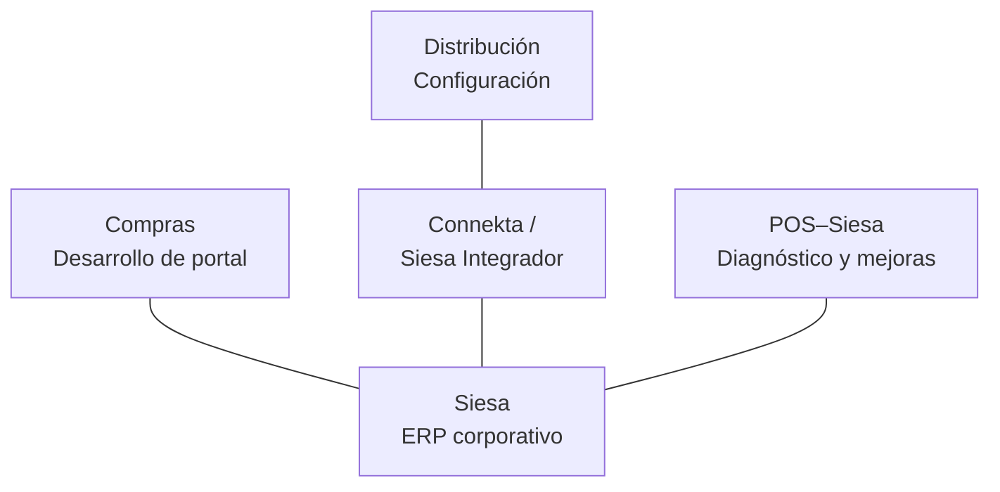

# Siesa: integración de ERP corporativo en compras, distribución y facturación

> Caso de estudio sobre trabajo de ingeniería realizado en sistemas empresariales en producción entre 2024 y 2026. Describe los problemas, responsabilidades y decisiones a nivel conceptual. No publica código propietario, consultas SQL reales, endpoints, configuración interna de plataformas, credenciales, estructuras de datos, identificadores de transacciones ni reglas comerciales detalladas.

---

## Contexto

Siesa era el ERP corporativo de referencia para procesos comerciales, inventario, compras y transacciones de la operación de retail. El reto no era implantar el ERP ni convertirlo en fuente de verdad: **ya cumplía ese papel**. El reto era conseguir que varias aplicaciones operativas intercambiaran información con él sin perder consistencia o trasladar errores entre sistemas.

Durante 2024 participé con otro desarrollador en tres frentes de integración: compras y requisiciones, distribución y facturación del punto de venta. La entrega principal de esa etapa ocurrió en septiembre de 2024. El trabajo no terminó con el despliegue: después hubo correcciones, optimizaciones y cambios de responsabilidad entre aplicaciones hasta 2026.

Los frentes estaban relacionados, pero no eran una única solución que yo hubiera diseñado e implementado íntegramente. Mi contribución fue distinta en cada uno:

| Frente | Mi responsabilidad principal | Límite de autoría |
|---|---|---|
| Compras y requisiciones | Adaptación y desarrollo de la integración del portal de proveedores con Siesa; evolución y soporte | Trabajo desarrollado en un equipo de dos personas |
| Distribución | Configuración de consultas, conectores y servicios suministrados mediante Connekta y Siesa Integrador | No desarrollé el aplicativo heredado de distribución ni los servicios SOAP del ERP |
| Facturación POS–Siesa | Revisión, diagnóstico de diferencias y optimización de la integración | El desarrollo inicial de ese flujo correspondió a otro desarrollador |

Esta distinción es parte del caso: integrar un sistema empresarial también puede requerir configurar una plataforma existente o identificar defectos en componentes que no son propios.

### Relación funcional entre los frentes

*Las líneas indican relación funcional con el ERP; no describen conexiones directas, endpoints ni flujos internos. Los servicios SOAP los gestiona la plataforma de integración.*

---

## 1. Compras y requisiciones: adaptar un portal existente

### Problema funcional

El proceso de compras necesitaba combinar información del ERP con la operación del proveedor y las necesidades de distintas tiendas. Un proveedor debía poder consultar un sugerido de compra, generar una orden y continuar el flujo que derivaba en requisiciones para los destinos correspondientes.

La dificultad no se limitaba a presentar los datos del ERP en una interfaz. Una orden no siempre se atendía por la totalidad de lo solicitado: los faltantes y entregas parciales obligaban a contemplar reglas de distribución de cantidades y a mantener coherencia entre la solicitud comercial y los documentos resultantes.

El portal ya existía como aplicación heredada en Django. En vez de reconstruirlo, trabajé en su adaptación para integrarlo con Siesa.

### Contribución técnica

Desarrollé la integración del portal con el ERP y participé en la implementación del proceso de órdenes de compra y requisiciones. Esto incluyó recuperar información de referencia, adaptarla al contexto de la aplicación y resolver transformaciones y cálculos necesarios para el intercambio de información.

El flujo funcional, explicado sin revelar estructuras internas, era:

1. El proveedor ingresa al portal y consulta información de compra procedente del ERP.
2. A partir de ese contexto, prepara o genera la orden correspondiente.
3. El proceso relaciona esa orden con las necesidades de los destinos operativos, considerando que las cantidades entregables pueden diferir de las inicialmente sugeridas.
4. Los documentos y estados deben poder interpretarse correctamente entre el portal, el ERP y los demás sistemas de la operación.

Las reglas exactas de asignación y las consultas empleadas son internas y no se reproducen aquí.

### Evolución posterior

La primera entrega quedó operativa en septiembre de 2024. Después continué corrigiendo y evolucionando el portal.

Una optimización relevante llegó en febrero de 2025: la consulta de sugeridos de compra dejó de depender de una importación accionada manualmente desde un único punto y pasó a obtener información de forma dinámica según el proveedor que ingresaba a la plataforma.

También se incorporaron mecanismos de registro para facilitar el seguimiento de las integraciones. El portal siguió cambiando, aunque no todas las mejoras posteriores correspondían directamente a la conexión con Siesa.

A finales de junio de 2026, la responsabilidad de realizar determinadas dispersiones o requisiciones pasó del portal a **LogiX**, que había evolucionado para asumir una parte mayor de la lógica operativa de distribución.

> **Decisión de ingeniería:** integrar un aplicativo heredado no obliga a congelar sus responsabilidades. A medida que cambia el dominio, algunos procesos pueden trasladarse al sistema que mejor los representa, sin implicar una reescritura total.

---

## 2. Distribución: configurar una plataforma de integración

### Contexto y alcance

El sistema de distribución heredado necesitaba intercambiar información con Siesa y transformar documentos para sus procesos operativos.

En este frente mi trabajo se concentró en **configurar integraciones**, no en desarrollar el aplicativo original. Utilicé **Connekta** y después **Siesa Integrador**, evolución de esa plataforma, para configurar los servicios web que me proporcionaban, las consultas y los conectores necesarios.

Es importante precisar el papel de SOAP: recibía las definiciones y direcciones de los webservices y las configuraba dentro de la plataforma. **La comunicación con esos servicios SOAP la realizaba Connekta o Siesa Integrador**, no un cliente SOAP desarrollado por mí.

### Qué implicaba la configuración

Desde el punto de vista de la integración, el trabajo exigía comprender qué información requería la operación, qué ofrecían los servicios del ERP y cómo representar las correspondencias entre las operaciones de los sistemas.

En términos generales, la plataforma permitía configurar consultas de información, servicios asociados al ERP y conectores para documentos. La dificultad consistía en adecuar esas capacidades a procesos comerciales concretos y comprobar que los datos circularan con el significado esperado.

No publico aquí las URLs de los servicios, los parámetros de autenticación, los documentos de configuración, las consultas SQL internas ni la topología de las instalaciones.

### Limitaciones observadas

El sistema heredado de distribución presentó posteriormente problemas de productividad y consistencia. Esos incidentes no deben atribuirse de forma simplista al middleware: el comportamiento de un proceso depende también de las decisiones del aplicativo consumidor y de las restricciones del sistema de destino.

La evolución de esa plataforma fue parte del contexto que llevó a reconstruir el producto logístico posteriormente documentado en **[LogiX](./case-study-logix.md)**.

Lo que aprendí aquí fue a distinguir **configuración de integración, lógica del consumidor y comportamiento del ERP**. Son capas distintas y requieren diagnósticos diferentes.

---

## 3. Facturación POS–Siesa: investigar inconsistencias entre sistemas

### Un frente distinto de la facturación electrónica

La integración de facturación del punto de venta con Siesa no debe confundirse con el proyecto de **facturación electrónica mediante un proveedor tecnológico**. Son flujos con propósitos y reglas distintas, aunque ambos parten de información comercial.

Un compañero desarrolló inicialmente el flujo POS–Siesa. Me incorporé después para revisar, diagnosticar y optimizar su comportamiento.

### Investigación de diferencias

Una dificultad recurrente eran las facturas cuyas cifras no coincidían con lo esperado, especialmente en las cuentas por cobrar del ERP.

No todas las diferencias tenían el mismo origen. Algunas se producían en las transformaciones del flujo de integración; otras ya existían en los datos entregados por el sistema de punto de venta.

Para distinguirlas, reconstruí casos individuales y comprobé cómo se interpretaban los importes a lo largo del proceso. En las situaciones que correspondían al tratamiento de la integración, incorporé correcciones sin modificar los registros originales de las transacciones. Cuando el defecto provenía del POS, se documentaba y coordinaba su revisión con la responsable de ese sistema.

La cuestión de ingeniería era determinar **en qué frontera se introducía la discrepancia**, en lugar de añadir correcciones indiscriminadas en cualquier componente.

### Una lección sobre reglas de datos

Que dos sistemas trabajen con la misma factura no significa que interpreten de igual manera sus importes, descuentos o estados. Al comparar resultados, es necesario conocer qué representa cada campo y qué transformaciones realiza cada proceso.

El criterio que desarrollé en facturación electrónica me ayudó a investigar estas diferencias, pero no significa que se pudieran copiar las mismas funciones de cálculo entre integraciones con requisitos distintos.

Las correcciones de este frente continuaron después de la salida principal a producción y se extendieron durante 2025.

---

## Evolución transversal: de entregar integraciones a sostenerlas

Después de la entrega inicial de 2024 continué atendiendo consultas, sincronización de datos, incidencias y cambios de las aplicaciones consumidoras. Esa continuidad convirtió una entrega puntual en una responsabilidad de mantenimiento en producción.

La experiencia mostró que la arquitectura de integración también abarca **los límites entre productos, los contratos de datos y las responsabilidades de cada sistema**.

---

## Resultados que sí puedo sostener

- Participación en la salida a producción, en 2024, de integraciones relacionadas con compras, distribución y facturación sobre Siesa.
- Desarrollo y evolución de la integración de un portal Django para el proceso de compras y requisiciones.
- Configuración de integraciones mediante Connekta y Siesa Integrador, utilizando servicios proporcionados por la plataforma del ERP.
- Optimización de la consulta de sugeridos por proveedor y mantenimiento continuo del portal.
- Diagnóstico y tratamiento de inconsistencias entre POS y Siesa, distinguiendo problemas del origen y de la transformación.
- Evolución de responsabilidades entre aplicaciones, con transferencia de procesos de distribución hacia LogiX en 2026.
- Continuidad como referente técnico en la operación y soporte de estas integraciones.

Estos resultados son cualitativos. No dispongo de una medición consolidada que permita atribuir al proyecto un porcentaje determinado de reducción de errores, una mejora cuantificada de latencia o ahorros económicos; por eso no presento cifras no verificadas.

---

## Límites y retrospectiva

**Siesa ya era la fuente de referencia.** La integración no convirtió al ERP en fuente de verdad: buscaba mantener a los sistemas consumidores alineados con ella. Esa diferencia importa para explicar correctamente el problema original.

**La consistencia requiere entender el dominio.** A veces una diferencia proviene de un dato incorrecto en origen; otras, de una transformación defectuosa o de supuestos distintos entre sistemas. Sin esa distinción, una corrección puede ocultar un problema y generar otro.

**No toda evolución exige rehacer el sistema.** Adaptar un portal existente y utilizar Connekta/Siesa Integrador fueron decisiones determinadas por la tecnología y los procesos disponibles. Cuando los límites del sistema de distribución dejaron de responder a la operación, apareció la necesidad de una transformación más profunda, abordada en LogiX.

**Las integraciones son relaciones de largo plazo.** El esfuerzo de diseño y entrega es solo una parte. La confiabilidad también se construye mediante seguimiento, diagnóstico, revisión de contratos de datos y adaptación a cambios de los sistemas involucrados.

---

## Reflexión

Este proyecto me enseñó a trabajar con integraciones de distinta naturaleza: unas requieren desarrollo de aplicación, otras configuración de middleware y otras investigación de incidentes entre componentes que pertenecen a responsables diferentes.

La principal habilidad que desarrollé no fue aprender a consumir un servicio particular de un ERP. Fue **reconstruir cómo circula y cambia la información entre sistemas, identificar la responsabilidad de cada frontera y corregir problemas sin perder de vista los procesos que dependen de esos datos**.

Esa experiencia dio contexto a decisiones posteriores en LogiX y al trabajo más reciente de integración de sistemas empresariales con herramientas para agentes.

---

[← Volver al portafolio](./README.md)
