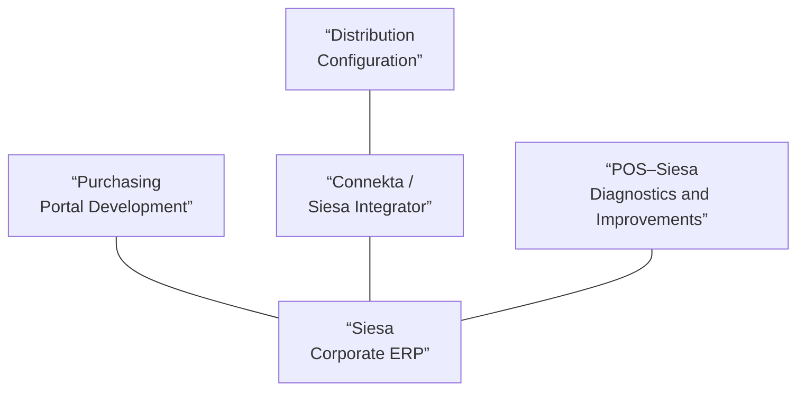

# Siesa: Integration of Corporate ERP into Purchasing, Distribution, and Billing

> Case study on engineering work performed on production enterprise systems between 2024 and 2026. It describes the problems, responsibilities, and decisions at the conceptual level. It does not disclose proprietary code, actual SQL queries, endpoints, internal platform configurations, credentials, data structures, transaction identifiers, or detailed business rules.

---

## Background

Siesa was the go-to corporate ERP system for business processes, inventory, purchasing, and retail transactions. The challenge wasn’t to implement the ERP or make it the single source of truth: **it already served that purpose**. The challenge was to get various operational applications to exchange information with it without losing consistency or passing errors between systems.

Throughout 2024, I worked with another developer on three integration fronts: purchasing and requisitions, distribution, and point-of-sale billing. The main deliverable for that phase was completed in September 2024. The work did not end with the deployment: subsequent corrections, optimizations, and shifts in responsibility between applications continued through 2026.

The areas were related, but they did not constitute a single solution that I had designed and implemented entirely on my own. My contribution was different in each one:

| Section | My Primary Responsibility | Scope of Work |
|---|---|---|
| Purchasing and Requisitions | Adaptation and development of the integration between the supplier portal and Siesa; ongoing development and support | Work carried out as part of a two-person team |
| Distribution | Configuration of queries, connectors, and services provided through Connekta and Siesa Integrator | I did not develop the legacy distribution application or the ERP’s SOAP services |
| POS–Siesa Billing | Review, diagnosis of discrepancies, and optimization of the integration | The initial development of this workflow was handled by another developer |

This distinction is part of the case: integrating a business system may also require configuring an existing platform or identifying defects in third-party components.

### Functional Relationship Between the Front Ends

*The lines indicate functional relationships with the ERP; they do not describe direct connections, endpoints, or internal flows. SOAP services are managed by the integration platform.*

---

## 1. Purchasing and Requisitions: Adapting an Existing Portal

### Functional Problem

The purchasing process needed to combine information from the ERP with supplier operations and the needs of different stores. A supplier had to be able to view a purchase recommendation, generate an order, and continue the workflow that resulted in requisitions for the corresponding destinations.

The challenge went beyond simply displaying ERP data in an interface. An order was not always fulfilled in its entirety: shortages and partial deliveries required the implementation of quantity allocation rules and ensured consistency between the commercial request and the resulting documents.

The portal already existed as a legacy application built with Django. Instead of rebuilding it, I worked on adapting it to integrate with Siesa.

### Technical Contribution

I developed the integration of the portal with the ERP and participated in the implementation of the purchase order and requisition process. This included retrieving reference information, adapting it to the application’s context, and resolving the transformations and calculations necessary for the exchange of information.

The functional flow, explained without revealing internal structures, was as follows:

1. The supplier logs into the portal and views purchasing information from the ERP.
2. Based on that context, the supplier prepares or generates the corresponding order.
3. The process links that order to the needs of the operational destinations, taking into account that the quantities to be delivered may differ from those initially suggested.
4. Documents and reports must be interpretable correctly across the portal, the ERP, and the other systems in the operation.

The exact allocation rules and queries used are internal and are not reproduced here.

### Subsequent Developments

The first version went live in September 2024. After that, I continued to refine and improve the portal.

A significant optimization took place in February 2025: the “suggested purchases” feature no longer relied on a manually triggered import from a single source but instead dynamically retrieved information based on the supplier logging into the platform.

Logging mechanisms were also incorporated to facilitate tracking of integrations. The portal continued to evolve, although not all subsequent improvements were directly related to the connection with Siesa.

In late June 2026, responsibility for carrying out certain distributions or requisitions shifted from the portal to **LogiX**, which had evolved to handle a larger portion of the operational distribution logic.

> **Engineering Decision:** Integrating a legacy application does not require freezing its responsibilities. As the domain changes, some processes can be transferred to the system that best suits them, without requiring a complete rewrite.

---

## 2. Distribution: Setting Up an Integration Platform

### Context and Scope

The legacy distribution system needed to exchange information with Siesa and transform documents for its operational processes.

In this regard, my work focused on **configuring integrations**, not on developing the original application. I used **Connekta** and later **Siesa Integrador**—an evolution of that platform—to configure the web services they provided, as well as the necessary queries and connectors.

It’s important to clarify the role of SOAP: I received the definitions and addresses of the web services and configured them within the platform. **Communication with these SOAP services was handled by Connekta or Siesa Integrador**, not by a SOAP client I developed myself.

### What the Configuration Involved

From an integration perspective, the work required understanding what information the operation needed, what the ERP services provided, and how to map the relationships between the systems’ operations.

Generally speaking, the platform allowed us to configure information queries, ERP-related services, and document connectors. The challenge lay in adapting these capabilities to specific business processes and verifying that the data flowed with the intended meaning.

I am not publishing here the URLs of the services, authentication parameters, configuration documents, internal SQL queries, or the network topology.

### Observed Limitations

The legacy distribution system subsequently experienced productivity and consistency issues. These incidents should not be simplistically attributed to the middleware: a process’s behavior also depends on the decisions made by the consumer application and the constraints of the target system.

The evolution of that platform was part of the context that led to the redesign of the logistics product, which was later documented in **[LogiX](./case-study-logix.md)**.

What I learned here was to distinguish between **integration configuration, consumer logic, and ERP behavior**. These are distinct layers and require different diagnostic approaches.

---

## 3. POS–Siesa Invoicing: Investigating Inconsistencies Between Systems

### A Different Aspect of Electronic Invoicing

The integration of point-of-sale invoicing with Siesa should not be confused with the project for **electronic invoicing through a technology provider**. These are workflows with different purposes and rules, although both are based on commercial information.

A colleague initially developed the POS–Siesa workflow. I joined the project later to review, diagnose, and optimize its performance.

### Investigation of Discrepancies

A recurring issue was invoices whose figures did not match expectations, especially in the ERP’s accounts receivable.

Not all discrepancies had the same cause. Some arose during the integration process; others were already present in the data provided by the point-of-sale system.

To distinguish between them, I reconstructed individual cases and verified how the amounts were interpreted throughout the process. In situations where the discrepancy stemmed from the integration process, I applied corrections without modifying the original transaction records. When the error originated from the POS, it was documented, and its review was coordinated with the person in charge of that system.

The engineering challenge was to determine **at which boundary the discrepancy originated**, rather than applying indiscriminate corrections to any component.

### A Lesson on Data Rules

Just because two systems work with the same invoice doesn’t mean they interpret its amounts, discounts, or statuses in the same way. When comparing results, it’s necessary to understand what each field represents and what transformations each process performs.

The methodology I developed for electronic invoicing helped me investigate these differences, but that doesn’t mean the same calculation functions could be copied across integrations with different requirements.

Corrections in this area continued after the main go-live and extended throughout 2025.

---

## Cross-functional Evolution: From Delivering Integrations to Maintaining Them

After the initial delivery in 2024, I continued to handle inquiries, data synchronization, incidents, and changes to the consumer applications. That continuity turned a one-time delivery into an ongoing production maintenance responsibility.

Experience showed that integration architecture also encompasses **the boundaries between products, data contracts, and the responsibilities of each system**.

---

## Results I Can Account For

- Participation in the 2024 go-live of integrations related to purchasing, distribution, and billing on Siesa.
- Development and enhancement of a Django portal for the purchasing and requisition process.
- Configuration of integrations using Connekta and Siesa Integrador, leveraging services provided by the ERP platform.
- Optimized the “suggestions by supplier” query and provided ongoing maintenance of the portal.
- Diagnosed and resolved inconsistencies between POS and Siesa, distinguishing between source and transformation issues.
- Evolved responsibilities between applications, with the transfer of distribution processes to LogiX in 2026.
- Continued role as a technical leader in the operation and support of these integrations.

These results are qualitative. I do not have consolidated metrics that would allow me to attribute a specific percentage of error reduction, a quantified improvement in latency, or cost savings to the project; therefore, I am not presenting unverified figures.

---

## Limitations and Retrospective

**Siesa was already the reference source.** Integration did not make the ERP system the source of truth: it sought to keep the consumer systems aligned with it. This distinction is important for correctly explaining the original problem.

**Consistency requires understanding the domain.** Sometimes a discrepancy stems from incorrect source data; other times, from a faulty transformation or differing assumptions between systems. Without that distinction, a correction can mask one problem and create another.

**Not every evolution requires rebuilding the system.** Adapting an existing portal and using Connekta/Siesa Integrador were decisions driven by the available technology and processes. When the limitations of the distribution system no longer met operational needs, the need for a more profound transformation arose—a need addressed by LogiX.

**Integrations are long-term relationships.** The design and delivery effort is only part of the story. Reliability is also built through monitoring, diagnostics, reviewing data contracts, and adapting to changes in the systems involved.

---

## Reflection

This project taught me to work with different types of integrations: some require application development, others middleware configuration, and still others involve investigating incidents between components managed by different teams.

The key skill I developed wasn’t learning how to consume a specific ERP service. It was **reconstructing how information flows and changes between systems, identifying the responsibility at each interface, and resolving issues without losing sight of the processes that depend on that data**.

That experience provided context for subsequent decisions at LogiX and for my most recent work integrating enterprise systems with tools for agents.

---

[← Back to portfolio](./README.md)
